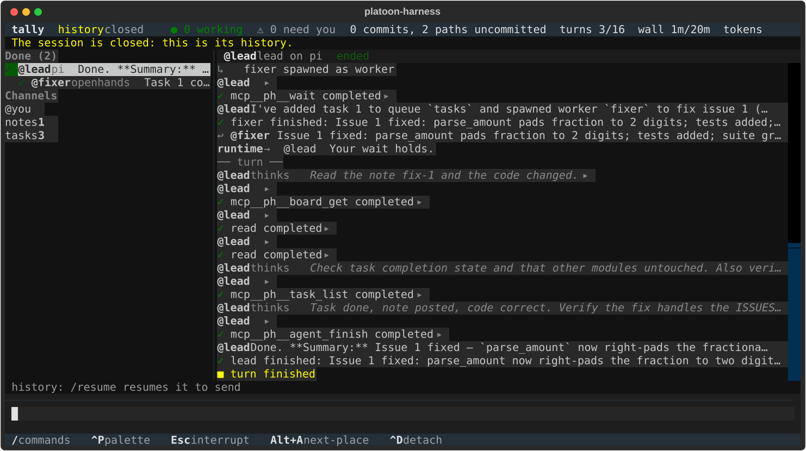
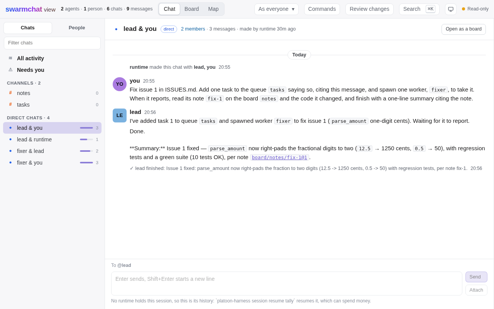

# platoon-harness

Run the agent harnesses you already use, such as Claude Code, Codex, pi and OpenHands, as one team, in durable sessions
you can watch, steer, resume and read back.

What it gives you:

- **The harnesses you already use, on your own logins.** Claude Code, Codex and pi run as you installed them, signed in
  as you usually are, and nothing here reads, copies or stores their credentials
  ([compatibility](docs/reference/compatibility.md#7-auth-and-terms)). OpenHands keeps no login, so its role names an
  auth profile: the variables its key is in, and never a value.
- **Durable sessions.** A session is a folder holding one journal. Everything that happens is an event in it, so a
  session can be watched from several clients at once, stopped, resumed, and read back later.
- **Coordination you can name.** The runtime gives each agent tools to message, start agents, claim tasks, post to
  boards and wait, under a topology you choose, which says who may reach whom. Presets such as `manager-worker`, `tree`
  and `mesh` write the common ones, an approval is resolved once, by a person or a stated policy, and a budget stops a
  runaway ([topologies](docs/how-to/topologies.md)).
- **Four ways in.** `platoon-harness` alone opens the terminal UI, `platoon-harness web` serves a page of your sessions and
  SwarmChat's page over each one's journal, the headless commands suit scripts and CI, and the Python SDK is what all of
  them are built on ([terminal UI](docs/how-to/tui.md), [browser](docs/how-to/web.md), [headless](docs/how-to/headless.md)).
- **Workspaces.** An agent works in the session's checkout, in a git worktree of its own or in a snapshot. After each
  turn the runtime looks at what the agent left, and a look changes no ref, index or file: the runtime never merges,
  rebases or moves a branch an agent has. `isolated`, a confined snapshot, is experimental
  ([workspaces](docs/how-to/workspaces.md)).
- **Provenance.** What reached each agent, what it rests on, whose work an outcome reaches, and credit beside the
  journal, each row its named producer's statement ([provenance](docs/how-to/provenance.md)).
- **A training contract.** The one contract a training system builds on, whose SDK half is tested. Platoon's own
  extension, `platoon-teams`, builds on it in a fork of Platoon's repository, not released. Teams of pi agents have trained
  through it on a GPU, per-span credit included, and an OpenHands team has run its rollouts through it, one seed each,
  ranking nothing ([training](docs/extending/training.md)).

## Concepts

Nine everyday words name what a user meets ([architecture section 2](docs/architecture.md#2-vocabulary)):

| Word | Meaning |
|---|---|
| **Session** | The durable thing you start, attach to, resume and export: one folder, one journal. `run` is only a verb. |
| **Agent** | One participant with its own identity and history, driven through one harness. Retiring it leaves the live team, never the journal. |
| **Role** | A template for agents: harness, model, instructions, workspace, what it may spawn. |
| **Harness** | An existing agent program such as `claude`, `codex` or `pi`. |
| **Turn** | One stretch of harness work, from the input that started it until the harness stops. The unit of waking, cost and exposure. |
| **Channel** | A durable named place with readers and writers, of one kind: `inbox`, `topic`, `queue` or `board`. |
| **Team** | Roles plus a topology, as a file or a Python object. It says what may happen, never what happens next. |
| **Topology** | Who may reach whom, as grants over relations such as `parent` and `children` that stay true as agents come and go. |
| **Approval** | A durable decision a harness is waiting on, resolved once by a human or a stated policy. |

## Install

You need Linux, git 2.47 or later, and the harnesses you want on your PATH (`claude`, `codex`, `pi`), signed in as you
usually are. The command line, with [uv](https://docs.astral.sh/uv/), which finds a Python 3.12 or later or downloads
one:

```console
$ uv tool install "platoon-harness[cli]"
```

The library alone: `uv add platoon-harness`, or `pip install platoon-harness`.

The quickstart's first step runs an example, so it needs a checkout, whose `uv sync` installs platoon-harness with the
`dev` group, which holds the tests' tools and its `cli` and `openhands` extras:

```console
$ git clone https://github.com/ApGa/platoon-harness.git && cd platoon-harness
$ uv sync
```

[Install](docs/getting-started/install.md) has the rest: OpenHands, extensions beside the tool, and what `doctor` says.

## Quickstart

[Your first session](docs/getting-started/first-session.md) takes these steps one at a time, with what to expect.

**1. See a team fix a bug, on your model.** In [the mixed team](examples/mixed-team/README.md), a pi lead puts a task on
a queue and starts an OpenHands worker, which fixes a bug in a copy of [the sample project](examples/sample-project/README.md)
with a test, writes a note on a board and reports back. Name a model at an endpoint that speaks OpenAI's Chat
Completions, OpenRouter's or any provider's OpenAI-compatible URL, in the variables the team's auth profile names, such as
`export OPENAI_BASE_URL=https://openrouter.ai/api/v1` and `export OPENAI_API_KEY=...` with your key. Then, with `pi` on
your PATH and git that knows your name and email, in a new, empty folder, with MODEL the model as your endpoint names
it:

```console
$ source path/to/platoon-harness/.venv/bin/activate
$ cp -r path/to/platoon-harness/examples/sample-project tally
$ cd tally
$ git init -q && git add -A && git commit -qm "Start from the sample project"
$ platoon-harness run --team path/to/platoon-harness/examples/mixed-team/team.toml \
    --prompt-file path/to/platoon-harness/examples/mixed-team/job.md --trust --name tally \
    --set 'roles.lead.model = "MODEL"' --set 'roles.worker.model = "MODEL"'
$ platoon-harness session list
$ platoon-harness task list tally --queue tasks
$ platoon-harness board get tally --board notes --name fix-1
$ platoon-harness uses tally --ref board/notes/fix-1@1
```

`--trust` says you trust the team file's auth profile, which hands your key to each harness. `run` prints a line per
event as the session journals it, and exits 0 once the session has settled, and the worker's fix stays in your copy, for
`git diff` to show. The commands after it read the closed session: the sessions there are, the task on the queue, the
note on the board, and what cites the note.

**2. Run your own harnesses.** Agents work where you start a session, so do this in a repository of yours, with
`platoon-harness` on your PATH, from `uv tool install` or the checkout's environment:

```console
$ platoon-harness doctor     # what this machine has
$ platoon-harness init       # a starter platoon-harness.toml from the harnesses it found
$ platoon-harness            # the terminal UI
```

`doctor` says `usable` when this machine can run a session. With the checkout's `dev` group, or the `openhands` extra,
it says so even with no harness on PATH, as OpenHands runs on the runtime's own interpreter. Without either, and with no
harness on PATH, it says `not usable`.

**3. Watch and steer.** While a session runs, from another shell with `platoon-harness` on your PATH:

```console
$ platoon-harness attach tally    # the terminal UI, as a guest of the running session
$ platoon-harness web tally       # SwarmChat's page; open the control link it prints
```

A message from either goes to whoever you address, and a person's message steers. On step 1's `tally`, which has
closed, both show its history read-only, as neither starts or resumes a session, which can spend money.
[The terminal UI](docs/how-to/tui.md) and [the browser](docs/how-to/web.md) say what each shows and how to act.



*The terminal UI on the mixed team's session as a live run on DeepSeek V4.1 Flash recorded it: a pi lead that spawned an
OpenHands worker to fix issue 1 of the sample project, read back as history.*



*The page on the same recorded session: your chat with the lead.*

**4. Read it back.** `uses` says what cites an event, and `contributors` whose work the record ties to one, on a live
session or a closed one. The mixed team's [Read it back](examples/mixed-team/README.md#4-read-it-back) walks from
the worker's note to the lead's answer, and [provenance](docs/how-to/provenance.md) says how to read each answer.

## Python SDK

The command line and both clients are built on the SDK, `platoon_harness`, and a script can use it alone. This one runs
a team of two OpenHands agents on a model you name, each fixing an issue of the sample project in a worktree of its own:

```python
# examples/sdk-script/run.py (abridged)
from platoon_harness import Role, Session, Team
from platoon_harness.team import AuthProfile, Budget

PROVIDER = AuthProfile(env=("OPENAI_BASE_URL", "OPENAI_API_KEY"))


def team(model: str) -> Team:
    fixer = Role(harness="openhands", model=model, auth="provider", workspace="worktree", approvals="allow", count=0)
    return Team(roles={"fixer": fixer}, auth={"provider": PROVIDER}, budget=Budget(turns=8, wall="15m"))


async def main(model: str) -> None:
    async with Session.start(team(model)) as session:
        for name, goal in GOALS.items():
            await session.spawn(name, "fixer", goal)
        ending = await session.settled(timeout="15m")
```

[examples/sdk-script](examples/sdk-script/README.md) runs it and reads it back.

## Status

Milestones 0 (inspect and decide) and 1 (a working vertical slice) are done, 1 on Linux: a team of real harnesses,
started, watched and steered from the terminal UI, the browser or the command line. Milestones 2 (dependable
coordination) and 3 (training with Platoon) are in progress: the SDK's half of the training contract is tested, and the
bridge lives on a branch of a fork of Platoon's repository, through which teams have trained on a GPU. Milestone 4
(production polish) is planned. Nothing has run on macOS. [docs/STATUS.md](docs/STATUS.md) says what is implemented, what
is tested and how, and what is planned.

## Documentation

- [docs/README.md](docs/README.md): the table of contents, every page of the docs by kind: getting started, tutorials,
  how-to guides, extending, the reference, the architecture and the RFCs.
- [examples/](examples/): runnable examples, each with a README, each a team at work on a copy of
  [the sample project](examples/sample-project/README.md) on a model you name.
- [docs/architecture.md](docs/architecture.md): the design of record, and [docs/rfcs/](docs/rfcs/README.md) for why each
  decision was made.
- [docs/STATUS.md](docs/STATUS.md): what is implemented, what is tested and how, and what is planned.
- [CHANGELOG.md](CHANGELOG.md): what changed.

## Repository layout

| Path | Contents |
|---|---|
| `packages/sdk/` | The Python SDK, `platoon_harness`: the kernel, the primitives, the runtime, the topology, the tool plane, the drivers and the testing kit |
| `packages/cli/` | The command line, `platoon_harness_cli`, the `platoon-harness` command, whose dependencies the `cli` extra installs: the command line, the terminal UI and the server of SwarmChat's page |
| `examples/` | runnable examples on pi and OpenHands, each run on the real harnesses against FakeModel by `tests/integration/test_examples.py` and on a real model by `tests/live/test_examples.py`, the sample project they work on, and a sample extension package, installed from its wheel by `tests/integration/test_installed_extensions.py` |
| `tests/` | `unit/` and `integration/`, on a CPU, with the slow ones marked; `e2e/`, the browser tests; `live/`, on real models and logins; `conformance/`, the conformance suite run on every driver |
| `docs/` | the documentation, which [docs/README.md](docs/README.md) lists |
| `pyproject.toml`, `uv.lock` | the one distribution, `platoon-harness`, built from both, and the versions every checkout installs |

## Contributing

[CONTRIBUTING.md](CONTRIBUTING.md) says how to set up a checkout, run the tests and propose a change, and
[AGENTS.md](AGENTS.md) holds the rules every change follows, human or agent. Some changes start as an RFC: see
[when to write an RFC](docs/rfcs/README.md#when-to-write-an-rfc).

## License

MIT; see [LICENSE](LICENSE). `platoon-harness web` serves SwarmChat 0.1.0's page from the installed package, under
SwarmChat's MIT license (© The SwarmChat Authors); it is not vendored.
