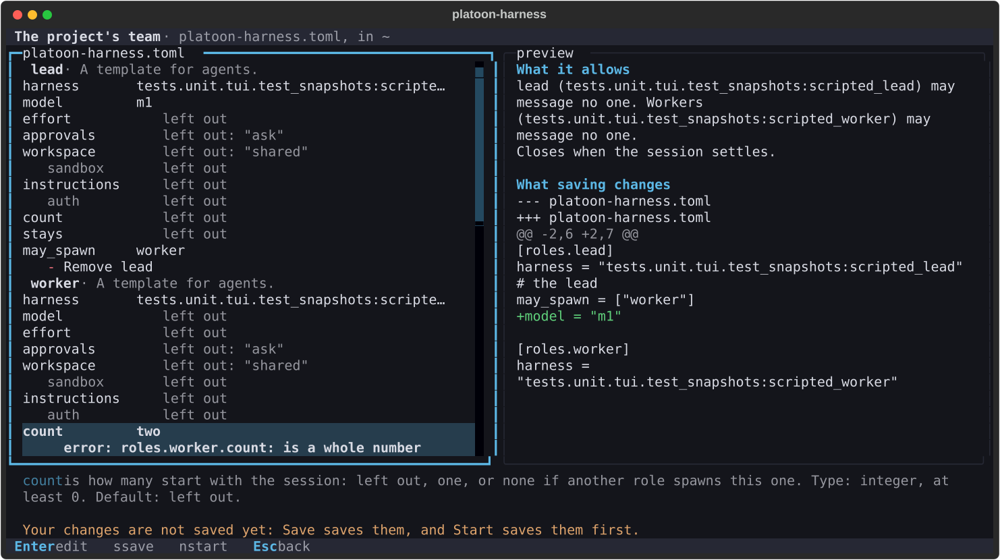

# Edit a team in the terminal or the browser

Set a team's roles, harnesses, models, efforts, topology, budget, labels and test command from the terminal or the
browser, and save them into the project's team file, `platoon-harness.toml`, which `run`, `team check` and both clients
read. The two editors draw the same fields, check a change the same way and say the same things, as both are made from
one module.

**Goal:** change the project's team, see each problem at the field that has it, what the team allows and what saving
changes, then save it and start a session from it.

**Prerequisites:**

- `platoon-harness` on your PATH, from a checkout installed as [Install](../getting-started/install.md) says, with its
  environment active as [your first session](../getting-started/first-session.md#5-set-up-your-own-team) has it;
- a project folder to run it in, with or without a `platoon-harness.toml`: with none, the editor starts one;
- a terminal, or a browser on this machine or on another that can forward a port to it, as
  [The browser](web.md#open-it) says.

## Open the editor

In the terminal:

```console
$ cd my-project
$ platoon-harness
```

On the sessions screen, press `e`, or click `e edit team` in its footer.

In the browser:

```console
$ cd my-project
$ platoon-harness web
platoon-harness: web: sessions link, which lists, starts, resumes and stops your sessions, as you: http://127.0.0.1:43117/#link=5e41…
```

Open the sessions link and press Edit under The project's team.

Either editor reads `platoon-harness.toml` from the folder you ran the command in, and what `doctor` finds of this
machine's harnesses, which takes a few seconds, as each harness is asked by its own status command. Read again, `r` in
the terminal, reads both again, asking first where that drops your changes.

## Change the team

Each table of the file is a group of fields: each role, the topology and each preset and channel it uses, the budget, the
labels, each auth profile and the test command. Each field is one key of the file, with what it takes and its default, in
[the reference's](../reference/team-file.md) words. Add a role with its name and harness, a channel with its kind, a
preset, a label or an auth profile under its section; Remove takes one away whole. A field left empty leaves its key out.

- **Harness** is one of the drivers this machine has, each with what `doctor` says of it: its version and the kind of its
  login, or why it is not here. A harness the file gives as a command or a `module:attr` shows as the file has it.
- **Model** and **effort** are free text. No list of models is offered, as no driver says which models its harness takes,
  and whether a harness honors an effort is known when an agent starts: one that cannot honor it fails the spawn.
- **Sandbox** is one its harness's driver declares. None can be set here, saying why, where it declares none, where its
  driver could not say, or where the role's harness is none this machine has a driver for.
- **Until** `program` leaves the session to the program that owns it, which a script starts: Start refuses such a team,
  as the choice says.

A change is checked as soon as it is made: the editor loads the team as `run` would, your user config beneath it, and
checks it as `platoon-harness team check` does. Each problem shows under the field it names, or the group that holds its
place, or at the top, each as `team check` says it. What it allows shows in `team show`'s sentences, and what saving
changes as a diff of the file. Only the newest check is drawn.

What only the file sets is kept as the file has it and named in its group: `extensions`, a `preamble`, a role's `tools`,
`delivery`, `inbox_depth`, `on_parent_exit`, `allow_native_children` and `budget`, `topology.groups` and
`topology.grants`, and a preset an extension gives or one used more than once. Edit those in the file.

### In the terminal



*The terminal's team editor at 120 columns by 32 rows, on a team of scripted harnesses, after the lead's model was set
and the worker's count was given as `two`.*

Each field is a row under its group: its key, and its value or what stands where it is left empty, with each problem
under it. The arrows choose a row, and the words of the chosen one show below the fields. Enter, or a click, opens a
field's form: a line of text, several lines, where Enter sets it and Shift+Enter starts a new line, or a list of its
choices, the one the file holds marked `●`. Enter sets it, and Esc leaves it as it was. `+ Add a role` and the other adds
open a form for the name and the field the entry needs, and `- Remove` takes the entry away. A row that cannot be changed
here is dim, and Enter on it says why. A field you type in whose value holds a control character a terminal would act on,
which the editor shows as its escape, cannot be changed in the terminal, as its form would draw that character to the
terminal itself: it says so, and you edit it in the file.

From 100 columns the preview stands beside the fields, and below them on a narrower screen, where Tab goes to it and the
arrows scroll it. After each change it shows the first line the diff changes, unless it has focus. The fields' panel says
`checking your last change…` while a check is under way. [The terminal UI](tui.md#edit-the-projects-team) has its keys.

### In the browser

A change is checked once you leave its field, or press Enter. Each group is a fieldset, each field labelled by its key,
with its words and its problems as its accessible description.

## Save, then start

Save, `s` in the terminal, writes the diff it showed into `platoon-harness.toml`, keeping your comments, the order of your
keys and their layout; a change you take back leaves the file as it was. It writes the whole file at once, never through
a link, and first compares the file with what the editor last read: a file found changed since, by you in another editor
or by anything else, is refused, nothing is written, and the editor shows your changes on what it holds now, for you to
save again. A change made in the moment between that comparison and the write is overwritten, as a rename cannot compare.
Save waits while a change is being checked, and is disabled, saying why, while there is nothing to save, or while the
loader refuses the draft or a change could not be made. What `team check` finds does not stop a save, as a team may name
a harness this machine lacks.

A save that writes a test command or an auth profile asks once first, in the same question in either editor, naming each
value as the team would hold it, as it is what would run as you or a credential to pass on. A start from the team asks
for trust again, as every start does.

Start saves the editor's changes first. In the terminal, `n` saves, then goes back to the sessions screen and opens its
start form on the project's team, which asks for a name and for trust as `n` there does. In the browser, Start with Team
file left empty starts from the project's team. The session's manifest keeps the team it ran, resolved, so what you saved
is on its record.

## Not built yet

- Changing a running session's settings, such as an agent's model: a session runs the team it started with.
- Editing a team file other than the project's, as `--team` names one.

[RFC 0079](../rfcs/0079-a-client-edits-the-project-s-team-file-in-place-from-fields-made-from-its-schema.md) has the
decisions behind this page.
