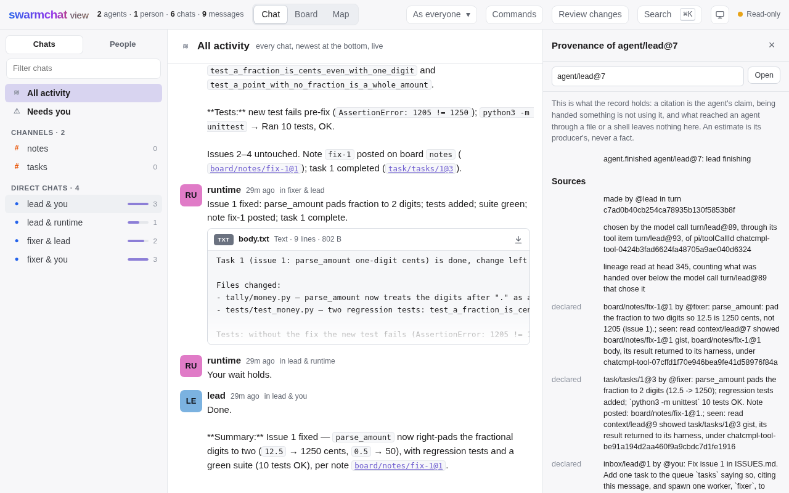

# Provenance

A session's journal says what each agent was handed, what it claimed to rest on, and what followed from what. This guide is how to
ask it. Section 11 of [the architecture](../architecture.md) is the design.

**Goal:** ask a session's journal what reached an agent, what an event rests on, what came of it and whose work an outcome
reaches, write an estimate beside the journal, and ask whether an agent's work can train.

**Prerequisites:**

- a session, live or closed, such as [the mixed team](../../examples/mixed-team/README.md)'s, whose writes cite what they
  rest on;
- for the Python blocks, the SDK, `pip install platoon-harness`, and for the commands at the end, the command line, as
  [Install](../getting-started/install.md) says.

## What an answer keeps apart

Three things stay apart in every answer, and none is ever drawn as another:

- **What an agent claims.** A citation, `based_on` on a write, is its writer's claim, checked to name an event and, for a range,
  lines of its body.
- **What reached it.** An offer the runtime made, and its harness's own report that it took it, is observed exposure. Seen means
  handed over and taken, never understood: a read's result returned to its harness, or, under Codex's `callId`, to the Code Mode
  script that made the call.
- **What an estimator thinks.** Credit and rewards are annotations, each by a named producer at a version, never facts.

## Refs and citations

Every event has a ref, `stream@version`, and `#La-b` names lines of that event's body: `board/notes/spec@3#L10-40`. Every result,
handover and notice names what it shows by one, and every write of content returns the one it made. A message that repeats another
event's words, an announce of a board write or a child's report, is shown by the ref of what it repeats, so one act has one ref.

The eight writes of content take `based_on`: `message.send`, `board.post`, `board.revise`, `task.add`, `task.complete`,
`task.fail`, `agent.spawn` and `agent.finish`. A citation must name an existing event, and a range lines of that event's body, or
the whole write is refused, so a citation says whether the event it names exists, and never what that event holds. A citation of
something its citer was never handed is kept, and `exposure` says so beside it. A commit cites through its `Informed-By` trailers:
a commit by its SHA, and an event of the session by its ref, such as the board entry the commit implements, so the walk back from
code reaches the messages and entries that informed it. An event's ref is checked as any citation is, and cites only in a commit an
agent of the session made, of an event that agent made or was handed, as `blob.get` reads: a trailer is text git carries between
clones and sessions, so a ref in a commit made elsewhere, or by nobody the record names, names nothing here. A value that cites
nothing stays as written, never refused, and lineage lists it as unresolved, saying why.

## Ask agents to cite

What an agent is told is a template, and the default asks every agent that holds a write of content, in one line of its own:

```text
When what you write rests on something you read, put its `ref` in `based_on`.
```

That line, the template's `{citing}` slot, is the one place an agent is asked: a tool's description says what `based_on` is and
never asks. A citation that names nothing, or no lines of its event, costs a refused write and its retry. A team that copies the
default and leaves the slot out asks nothing, and its agents' citations are still checked and kept. How often agents cite has not
been measured, so how thin or full an answer here is depends on the agents.

## Ask the record

Four queries answer people and programs, from a live session or a closed one, and none is an agent's tool:

- `exposure(agent, ref, before)`: whether one event reached one agent through us before another, `seen`, `not_seen` or `unknown`.
- `lineage(ref)`: one hop back, who made an event, in which turn and model call, what it cites and what it followed from.
- `uses(ref)`: one hop forward, what cites an event, what followed from it, and who was handed it.
- `contributors(ref)`: each maker a walk back from an outcome reaches, and apart from them those only handed to one.

This reads an event's citations with what its writer had been shown of each:

```python
async def citations(session, ref):
    """Each ref an event cites, its maker, and whether the event's own maker had been shown it before writing."""
    traced = await session.lineage(ref)
    rows = []
    for cited in traced.declared:
        answer = None if cited.exposure is None else cited.exposure.answer
        rows.append((cited.ref, cited.maker, answer))
    return rows
```

`lineage` names the model call that chose the event when the harness's ids join one, and its answers stop there: what the agent's
harness reported taking before that call counts, and nothing after. With no call joined, an answer stops at the event's commit and
says `commit`. A git commit is recorded by the look that found it, after git made it at a time the record does not hold, so its
answers stop at that look and say `look`: what counts may have come after the commit. Every answer names its `head`, and is `open`
while the turn its event was made in has not ended, since a later report can still confirm what was handed over. A ranged citation
says whether its lines were shown as exposure says whether its event was: true when a confirmed offer showed them, and otherwise
null, as no answer can say they were not.

## What an offer showed

An offer records what it showed by the ref of each event and a digest of what it showed of it, never the text. `context.show(offer)`,
`Session.shown(offer)` and `platoon-harness context show`, gives that text back by the offer's ref, `context/<agent>@<version>`,
item by item in the offer's order: a gist as it was shown, with any fields beside it, as a board entry's are, and a body or the
lines of one. Each is given where the journal proves it by the item's digest, and is null where it does not, as for a body redacted
since or one past 64 KiB, which the journal keeps outside it. A training system shows a model call's inputs this way.

## Spans

`spans(agent)` cuts each turn of an agent where its model calls chose its writes: a turn is cut after each call that chose one of the
eight writes of content, and a trailing piece with no write joins the span before it, so every call its harness reported in a turn
lies in one span, and no span crosses a turn. A call chose a write only where the record joins them, as `lineage` names the call that
chose an event: a write whose op came under no tool call's id, or whose tool item names no call, cuts nothing, and a claim, a read
and an announce of a write are no writes. Each span is named by its last call's `model.called`, with its first call, its turn's name
and the writes the record ties to its calls, oldest first and a page at a time beside its true count, and the answer is `open` while
the agent's latest turn has not ended, as a tool item reported late can still join a write and cut that turn again. A worker that
claims and completes three tasks in one turn, a call for each, has three spans, each ending at a completion, the last holding its
last words. [compatibility.md](../reference/compatibility.md), Provenance per harness, says where each harness's turns are cut.

Each span also names the claims its agent held while its calls were made, and the labels of the work it was done for, from the
team's vocabulary: those of the task it held, else those its agent was spawned with, else none. Where the record cannot place a
claim or its end to say whether a span held it, as a claim tied to no call in a turn that was cut, the span's claims are `None`,
unknown, and where the labels of what it held or may have held differ, so are its labels, never one of them:

```python
async def labelled_spans(session, agent):
    """Each span of an agent's, by its name, with the claims it held and the labels of its work, None where unknown."""
    found = await session.spans(agent)
    return {span.ref: (span.claims, span.labels) for span in found.spans}
```

## Who reached whom

`interactions`, `Session.interactions` and `platoon-harness interactions` count the agent interaction graph from the record: each
pair of makers, an agent, a person, a program, the runtime or nobody the record names, with how many edges lead from the first's
events to the second's by each kind, counted apart and never summed: `declared` citations, which their citers claim, `observed`
offers a harness said it took, `cause` and `ancestry`. An offer no harness has said it took is counted beside them as
`unconfirmed`, which is unknown. A maker's events that rest on its own are its history and make no pair, and a pair runs one way,
so Alice reaching Bob and Bob reaching Alice are two. Each agent comes with why what reached it is unknown: the surfaces no result
proves observed, which today is every one, and the gaps content could come through. So an agent no pair names has not been shown
to be reached by nobody. Pairs come oldest first and agents in the order they were spawned, 32 of each a page, and the cursor runs
until both are through, carrying the head the first page was read at, so every page of one answer agrees:

```python
async def who_reached_whom(session):
    """Every pair, as who, whom and its counts, and every agent with unknowns, all read at one head however many pages
    they take."""
    found = await session.interactions()
    pairs, unknowns = list(found.pairs), list(found.unknowns)
    while found.cursor is not None:
        found = await session.interactions(after=found.cursor)
        pairs += found.pairs
        unknowns += found.unknowns
    kinds = ("declared", "observed", "cause", "ancestry", "unconfirmed")
    counted = [(pair.who, pair.whom, {kind: getattr(pair, kind) for kind in kinds}) for pair in pairs]
    return counted, [row.agent for row in unknowns]
```

An answer is `open` while an offer it counts as unconfirmed went to an agent that had not ended, whose harness can still say it
took it, so asking again later may find it observed.

Each page walks the journal to its head and stores nothing, so it slows as a session grows. A pair counts reach in the record and
is never credit. `/reached` in the terminal, and Who reached whom in the page's top bar, draw it, each pair a heading over a line
for each kind of edge.

## Follow it in the terminal and the browser



*The Provenance pane of the lead's answer, on the mixed team's session as a live run on DeepSeek V4.1 Flash recorded it.*

A person follows provenance from where they read: `p` on the chosen line in the terminal, or `/provenance` with a ref,
and Provenance among a message's actions in the browser, on a view link too. Both show one event at a time, in the same
words, in four parts:

- **Sources:** who made it, in which turn and model call, what it cites, with what its citer had been handed of each, its
  causes, and its previous version or a commit's parents.
- **Uses:** what cites it, what follows from it, its next version, and each agent it was handed to.
- **Contributors:** each maker a walk back along citations, causes and ancestry reaches, with the kinds that reached it,
  weighing and ranking nobody.
- **Credit and rewards:** what estimators said of it, each by its producer, version and params, never summed; on a model
  call, first which span the call lies in, as a credit row on a span's last call is the whole span's.

Each link is labelled by how it is known, `declared`, `observed`, `cause`, `ancestry` or `gap`, and following one shows that
event's provenance; a line that opens nothing says why. Each part says the head it was read at, where it stops counting,
and whether its turn was still open, and what was not said below a bound reads as not said there, never as never.

A ref a message's text names, standing apart from the words around it, is a link in both clients, and shows that ref's own
provenance, saying first that it was opened from a ref in text: naming an event in text is no citation, so nothing checks
it. A ref can be opened by hand too, through `/provenance`'s form in the terminal or the pane's field in the page.

## What `unknown` means

`unknown` lists its reasons: offers its harness had not said by the bound that it took, surfaces of the agent's harness no stored
conformance result proves observed, and gaps content could have come through. An empty list of offers is how "not handed over
through us below the bound" reads, which is not "never seen": every harness here has a shell, and what reaches an agent through a shell, a file or git leaves nothing in the
journal. So nothing answers `not_seen` today. [compatibility.md](../reference/compatibility.md), Provenance per harness, says what each harness's
reports let the runtime confirm and join.

## Contributors are not credit

`contributors` follows citations, causes and ancestry back from an outcome, at most 4,096 events, and names each maker in the order
it reached them, with the kinds of edge that reached each. A maker whose work was only handed to one of them is listed apart, as
being handed something is not using it, and the walk does not go through them. Nobody is weighed or ranked: that is an estimate, and
an estimate is an annotation. `propagate@4`, an estimate, also follows what a span's harness confirmed taking, so a maker listed
apart here can still earn credit there.

## Write credit

An estimator reads the record, then writes what it found beside the journal, in `annotations.sqlite`, with no runtime, on a live
session or a closed one. `Session.annotate` and the `annotate` command are the one way in, and each statement is checked against
the journal: it names its producer and version, the events it is about and rests on, and the `head` it read at, which names the
trace, and each of those events lies at or below that head. Its status is `scored`, `invalid`, `error`, `timeout` or `cancelled`,
and a value is given when it is `scored` and only then, so no other is ever zero; an event nobody said anything of is unscored,
which no status says. A team's reward targets its episode's `episode.closed`, an agent's its first `agent.started`, never the
spawn its spawner made, and a span's the `model.called` of its last call, which names it. A second estimator, or a second
version, writes beside the first. This one is a toy, labelled as one, and its target is an event of each agent's own, the first the walk reached,
never a spawn:

```python
async def even_split(session, outcome):
    """A toy estimator: an even share of an outcome for each agent the record ties to it, which is a heuristic."""
    found = await session.contributors(outcome)
    agents = [row for row in found.rows if row.maker and row.maker.startswith("agent:")]
    for row in agents:
        await session.annotate(
            row.first,
            kind="credit",
            producer="even-split",
            producer_version="0",
            scope="team",
            status="scored",
            value=1 / len(agents),
            params={"outcome": outcome},
            evidence=[outcome],
            head_seq=found.head,
        )
    return await session.annotations()
```

A client shows a value only with its producer and version, beside any other estimate of the same target, and never sums two: the
terminal's and the browser's provenance list each under Credit and rewards, as it was said.

The SDK ships one producer, `platoon_harness.credit.propagate`, `propagate@4`, a heuristic run only when someone runs it: it
splits an episode's team reward over what the episode closed on, back along causes, citations and what each span confirmed
taking, and writes a `credit` row for each span and each agent it reached. Citing or taking gives away all but `retained` of
what reaches an event, so training on it pulls against the default template's request to cite, as
[training.md](../extending/training.md#write-rewards-and-credit) says with how it splits.

## What can train

`eligibility` says whether an agent's work in one episode can train, from the record alone, and what trains is the training
system's to decide:

```python
async def what_can_train(session, agent, episode):
    """An agent's attribution and verdict in an episode, and each bar to training it or any call of its met."""
    answer = await session.eligibility(agent, episode)
    bars = [bar.reason for bar in answer.reasons]
    while True:
        bars += [bar.reason for call in answer.calls for bar in call.reasons]
        if answer.cursor is None:
            return answer.attribution, answer.verdict, bars
        answer = await session.eligibility(agent, episode, after=answer.cursor)
```

An agent is `exact` where every start of it recorded its trainable level met and no other agent's admission names any of its backend
ids, and `forked` once a native child of its harness is seen. Its bars are `not_trainable`, with the level its start recorded,
`shared_key`, for an entry of its backend ids another admission names too, `forked` and `no_end`, and a call's own are
`outside_episode`, `person`, for a turn a person held or a person's entry its agent was handed before it, and `purpose`, for a
purpose its harness gave other than `compaction`: a call reported with no purpose is its turn's. A program's message is no
person's. It reads the levels each start recorded, so a result kept or lost since changes no answer.

## Use the command line

Each query is a command of its name, and prints its answer as JSON:

```console
$ platoon-harness lineage fix-auth --ref task/tasks/1@3
$ platoon-harness contributors fix-auth --ref task/tasks/1@3
$ platoon-harness exposure fix-auth --agent @lead --ref task/tasks/1@3
$ platoon-harness eligibility fix-auth --agent @lead --episode task-17
$ platoon-harness spans fix-auth --agent @lead
$ platoon-harness annotate fix-auth --target task/tasks/1@3 --kind credit --producer mine --producer-version 1 \
    --scope local --status scored --value 0.5 --head-seq 812
$ platoon-harness annotations fix-auth --target task/tasks/1@3
```

[examples/mixed-team](../../examples/mixed-team/README.md) runs a team whose writes cite what they rest on, and asks `uses` and
`contributors` of its lead's answer.
