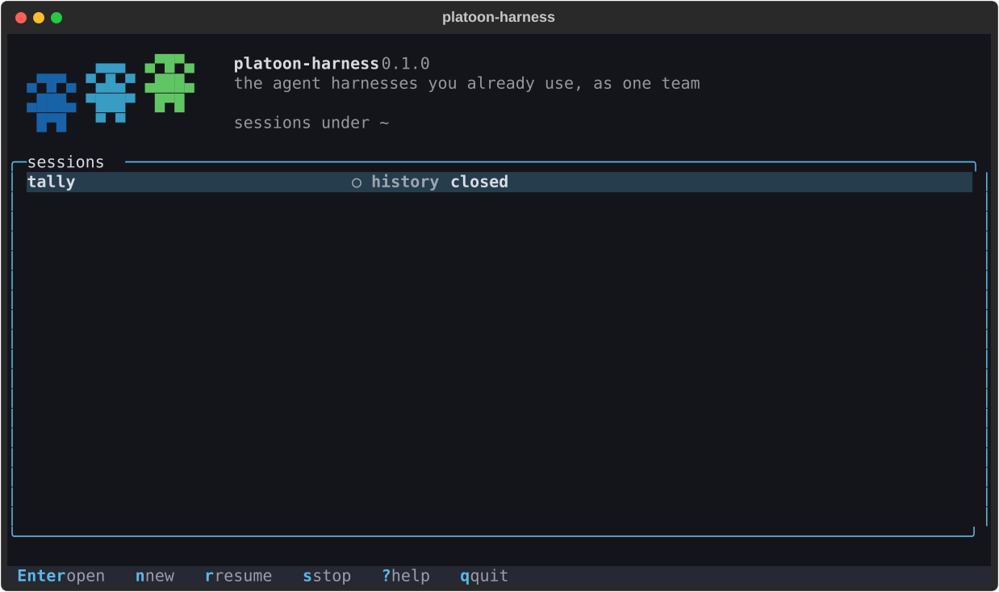
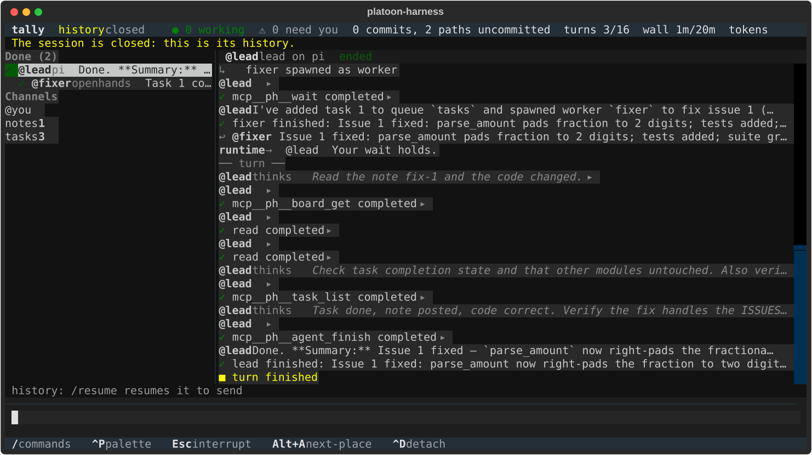

# The terminal UI

This guide shows how to start, watch and steer sessions from a terminal. `platoon-harness` on a terminal opens the terminal
UI. It is a client like any other: it submits ops and draws the views, holds no timer that decides anything, and computes no
status. [cli.md](../reference/cli.md) is the command line's reference and [headless.md](headless.md) runs the same sessions with
no terminal.

**Goal:** open a session in a terminal, see who is working and what needs you, answer it, steer an agent with a message, and
see what changed and where a line came from.

**Prerequisites:**

- `platoon-harness` on your PATH, from a checkout installed as [Install](../getting-started/install.md) says, with its
  environment active as [your first session](../getting-started/first-session.md#5-set-up-your-own-team) has it;
- a session to open, such as [your first session](../getting-started/first-session.md)'s, which runs on a model you name, or the
  harnesses you use on your PATH, signed in as you usually are, to start one, from a team of yours or one the sessions
  screen writes.

## Open it

```console
$ platoon-harness                 # the sessions screen
$ platoon-harness attach fix-auth # one session
```

With no terminal, `platoon-harness` prints its help, since nothing ever prompts with none, and `attach` exits 64 and names
`events --follow`. A session started here gets a detached runtime of its own, the way tmux starts its server, and the UI is
its guest: `/detach`, or Ctrl+D, detaches and the session runs on, and `attach` comes back to it.

## Every act from any terminal

A chord is a shortcut and never the only way: every act also takes only keys every terminal delivers, which are
printable characters, Enter, Esc, Tab, Shift+Tab, the arrows and Backspace.

- In the composer, a line that is exactly `/` and an act's name runs that act and goes to no agent: `/next-place`, `/yes`,
  `/interrupt`, `/detach`, `/quit`. Each act has one name, kept in the keymap table beside any key, and the help, the
  palette and the keymap below show it there.
- `/` alone, or `/help`, lists them, and the footer always begins `/ commands`. `/` from any other part goes back to the
  composer and begins one there.
- Anything else that begins with `/` is asked about before it goes as a message, since a harness's own commands are not
  built yet.
- A typed command not built yet says why, as its key does.
- No chord decides, stops or spends anything: a terminal sends Alt and a letter as Esc then that letter, so Esc then a word
  typed at once would run one. `/yes`, `/no`, `/stop-below` and `/resume` have no key.
- Tab and Shift+Tab go round the parts in the order they are on screen: the navigator, the transcript, the dock and the
  composer.
- Only Tab or Shift+Tab moves focus to the dock, and its `y` and `n` act only on a place chosen there with the arrows: it
  takes focus with no place chosen, and a character it does not take lets go of the one chosen, in the order the keys
  come, so a stray Tab from a draft, then the draft going on, answers nothing. A click chooses a place and gives no focus.
- A part hidden while it has focus, by a resize, `/navigator` or a dock left empty, gives focus back to the composer.
- Esc in the composer interrupts the agent in view, and from any other part goes back to the composer, interrupting
  nothing, but that in the transcript it first closes the chosen line one level. The footer names Esc by what it does
  from the part with focus, and that part is marked by more than its colour: the navigator and the focus pane by a heavy
  border, the composer by its cursor and the dock by its band and the line that says how to choose a place.
- Where nothing is typed, on the sessions screen, in a question, a form or the help, every act has a plain key, quitting
  included.

## The sessions screen



*The sessions screen on the mixed team's session as a live run on DeepSeek V4.1 Flash recorded it, at 100 columns by 28
rows.*

Every session under the root, whether a runtime holds it and its state, and it works with none. With nothing where the
project's `platoon-harness.toml` goes, in the folder you started it in, it offers once, as it opens, to write one from
the harnesses on your PATH, as `init` does: a lead on the first, which starts workers on the second. Only `y` takes the
offer, and turned down it is not made again until the screen opens anew. It writes over nothing, nor through a link:
anything put there meanwhile stays as it is, and it says nothing was written. With no harness on your PATH it says so.
`n` starts a session from the project's `platoon-harness.toml` or a team file. When several agents would run on your own
plan login it asks once whether this is your own work, which is the SDK's `plan_login`. An agent the session starts with
whose harness cannot start fails, as the workspace shows, and for a harness `doctor` looks for, the terminal UI also
says what `doctor` finds of it, run in this terminal, in its words: not on PATH, or its version, the kind of its login
and what its checks found. The session's runtime has this terminal's environment, so PATH is the one the harness was
looked for on, but an agent in an isolated workspace keeps its harness's state in a home of its own, so the login
`doctor` names is this terminal's, not that harness's. `r` resumes a session whose runtime has gone, after saying that it can spend money. `s` stops one as its owner
would, after one confirmation, and it stays resumable. Enter opens one: live as a guest, or as read-only history when no
runtime holds it, with `/resume` offered to resume it. `/detach` comes back here from a session opened here, which runs
on. `l` looks again, `t` chooses a theme, `c` copies what you selected, `?` shows every key, `p` opens the palette and
`q` quits. In a form, Enter goes to the next field,
and from the last sends it.

## The workspace



*The workspace on the mixed team's session as a live run on DeepSeek V4.1 Flash recorded it, at 120 columns by 32 rows: a pi lead
that spawned an OpenHands worker, read back as history.*

| Part | What it answers |
|---|---|
| Header | The session's name and how it stands, who is working, how many places need you, what is blocked or failed, what changed, as commits and paths uncommitted, `not measured` until the first look and `not observed` when the session's cwd is in no git repository, and each limit with what is spent against it, a meter beside it where the amount is known, `?` where nobody could say, and how many turns nobody measured whole |
| Navigator | Platoon's agents beside the session's name, then the agents grouped by what you must do, needs you, working, blocked, idle, done and failed, as a tree by parent, each with its glyph, its name, and under it its state, its harness and what it is on or waits for. Channels below, with how many lines you did not write lie past your mark, and a mark for a mention you have not read |
| Focus pane | One agent, one channel or one thread at a time, so live text is never merged, its title what is in view and, for an agent, its role, harness and state |
| Inspector, `/inspector` | Why an agent waits, whether it rests with no process until its next message, its harness, model, login kind and levels, its workspace, with its branch, the commit it started from, a line on what an isolated one still reaches, and why its stop kept it, what it spent with labels, its gaps, and what the runtime refused you |
| Dock | Each place you must act, from the `attention` view, with its actions. A place its agent's next turn settles, a lost turn, a wake past `max_hops`, a failure or a conflict of an agent's, offers Write to it, a mention Reply, and a dead task Add it again, each opening its op's form. An agent's conflict says to tell it, or to resolve it in your own checkout, never in its workspace, where a commit is recorded as the agent's. Your checkout's has no action, and says to resolve it there, a failure of no agent's that nothing tries it again, and a daemon that keeps failing where its traceback is and what starts it anew |
| Composer | What you write, and above it whom it goes to and what waits for that agent |

The groups come from the roster's `group`, so every client says the same. Your unread counts and the mentions you have
read come from your marks in `marks.sqlite`: reading a channel to its newest line moves them, and moving them is no event
and acknowledges nothing an agent was handed. Leaving writes each mark still being written, so what you read stays read. It is the one file the terminal writes reading a session, history too. One that cannot be
read or written loses only badges, which is said once.

### How it looks

The workspace is drawn in titled panels with thin rounded borders, the one that has focus heavy and in the accent, on a
dark ink background with one accent colour, the logo's sky blue: the theme `platoon-ink`, which the owner chose.
Warnings, `history` and what needs you are a muted amber in it, never a yellow, and each is told apart by its glyph and
its words as well. `/theme`, or `t` on the sessions screen, chooses another of Textual's themes for this run,
`ansi-dark` among them, which draws in your terminal's own colours, and it says the line that keeps it: `theme = "nord"`
in `tui.toml`, in `$XDG_CONFIG_HOME/platoon-harness`, or `~/.config/platoon-harness` where that is not set, beside the
user config a team loads. `tui.toml` takes two keys: `theme`, the name of a theme, and `motion`, which `false` turns
off. A file that cannot be read, holds any other key, gives either as another kind of value, or names no theme there is,
is not taken at all, and it says why, every problem at once, with the nearest key or theme to one misspelt, and what
stands instead.

Platoon's agents stand at the navigator's top, three marching up, and on the sessions screen beside the wordmark, three of
one size, round-headed with big white eyes, the middle one a step ahead: sprites drawn by hand from the icon of
[Platoon](https://github.com/ApGa/platoon) (MIT, © Apurva Gandhi), two pixels to a cell in half blocks, in the icon's blue
to green, and in your terminal's own blue, cyan and green under a theme that keeps to them. The header says the session's
name and how it stands, so nothing stands beside the small ones. On the sessions screen the large ones stand where the
screen has the rows and the columns beside the words, and small ones where it does not, and a line too long for the screen
is cut at its edge, so the logo is never torn.

Each agent's state has a glyph as well as a colour, so neither alone says it:

| Glyph | State |
|---|---|
| `◉` | needs you |
| `●` | working, which stirs while motion is on |
| `◌` | blocked |
| `○` | idle, which breathes while motion is on |
| `✓` | done |
| `✗` | failed |
| `⊘` | lost: the runtime lost it |
| `?` | unknown: a state this terminal does not know |

The header holds the session's name and how it stands, how many agents work and how many places need you, how many agents
are blocked, failed or lost, what changed and each limit with what is spent against it, a thin meter beside each where the
amount is known. Where it does not fit, what decorates it goes first, the meters, then the amounts spent with no limit, then
all that is spent, then what changed; how many turns nobody measured whole goes with each amount in tokens or dollars it
leaves short, and under 60 columns the name and the counts stay, in glyphs alone. The counts never give way. When an agent
comes to need you while another is in view, a toast names it and why it waits, and says that Alt+A, or `/next-place`, goes
to each place you must act, in turn. That order, and the toast, are the defaults pending the owner's ruling.

### Motion

The agents move a little, at four frames a second at most, from the session's state as its record says it and from
nothing else:

- While agents work, the logo's agents step in turn, faster as more work, one step a second for one, and a working
  agent's `●` stirs.
- While every agent that has not ended rests, they blink now and then, one at a time every six seconds, and a resting
  agent's `○` breathes while the session is live.
- On an event, a flourish under a second: the front agent waves as an agent finishes or the session settles, their eyes
  look up at you in amber as one comes to need you, and they stir as more start working.

A session that is history, which no runtime holds, never moves, and an agent whose state is unknown shows no motion that
would say it works or rests, nor does the logo blink while one is unknown. The sessions screen's logo stands still, as that
screen reads no agent's state. Only the logo's rows and the glyphs that move are drawn again, and only when their frame
changes: a live session at rest took 0.6% of a core, measured. `motion = false` in `tui.toml` turns it off, and so does
Textual's animation level below full, as `TEXTUAL_ANIMATIONS=basic` or `none` sets it. Its timer decides nothing.

The mouse does what a key does, and each key still does it: a click on a row of the navigator, or a tab of the strip under
80 columns, shows that agent or channel, as Alt+↓ goes to it; a click on a line chooses it, as the arrows do, and a click
on its `▸` or `▾` opens or closes it, as Enter does; the wheel scrolls, as PgUp and PgDn do; and a drag of the navigator's
edge widens or narrows it, as Alt+→ and Alt+← do, from 24 columns to 64.

### The transcript

An agent's transcript shows what it said, and folds the rest away, in levels you open as you need them:

1. **A turn.** A rule across the transcript marks its start. Under the agent's name stand what it said, its messages,
   and its report, always, each whole, wrapped at the edge. All else it did in the turn is one quiet line that counts it
   exactly, `▸ 5 tool calls · ✗ 1 failed · 3 thoughts · 1 spawn`, standing where the first of it stands: its tool calls
   and patches, with how many failed, how many are running and how many ended unknown, as did a call whose turn ended
   with no end of it recorded, or whose end says not how it ended, its thoughts and its spawns. Where the window does
   not hold the turn's start, it says more came before, and where it holds neither the turn's end nor the newest lines,
   as when it was read from the journal's first line, that more comes after, not read yet, and a call there with no end
   says its end is not read yet.
2. **What it did.** That line opens on each step in its place among what was said: a call as its tool's name and its
   input in short, the values of its JSON, with `✗` and the word for how it ended where it failed, and `? ended unknown`
   where that is not said; a thought as one dim line; a patch; and each spawn under the call that made it.
3. **The whole of one.** A step opens on all of it: a call on its whole input, laid out, and what it gave back, a thought
   on its text, a message on its body as Markdown and code, an approval on what it asks, each with where it came from.

Ended turns rest folded. While a runtime holds the session, a turn under way also shows its latest step under its line,
`running` where it has no end yet, so you see what an agent is doing now; once the turn ends, it rests folded too.
Nothing a fold holds is out of reach: each line opens, and a fold never hides that something failed, waits on you or is
unknown. An approval an agent asks for, a gap, a turn that ended other than finished or stopped, and a child that ended
stand among what was said, and a fold says how many of its calls failed or ended unknown. A turn's ordinary end,
finished or stopped, draws no line, with steps or none, as the next turn's rule and the agent's state say it. A tool is
named only where its harness reported it by a name and its input as JSON, as a model's call is reported; a command a
harness ran, as Codex reports one, is its words whole, its first word no name. That ended turns rest folded, that a turn
under way shows its latest step, that a turn's ordinary end draws no line, and these keys, are the defaults pending the
owner's ruling.

With the transcript in focus, Enter opens or closes the chosen line, Right opens it one level and, on a fold already open,
goes into it, and Left or Esc closes it one level, or from a step goes out to its fold's line; Esc with nothing open there
goes back to the composer. Ctrl+O, or `/folds`, from anywhere opens every fold of the focus, and each that comes after, and
again closes them all. `/open-line` opens or closes the chosen line from the composer.

Each run of lines one speaker says stands under one heading, its name in the accent, or the sender and where it was sent,
`@you → @lead`. A line of the runtime's own stands alone. A blank row stands before each new speaker, each line of the
runtime's own after a speaker's, and each turn. A line reads its words as Markdown, its emphasis and code styled and their
marks gone, and `▸` after them where it opens on more than its words, such as a body. What an agent says in a turn with a
gist of whitespace alone, as a model can before a tool call, says nothing and is drawn as no line once its body is read and
blank too, or at once where it has none; one whose body is unread, cannot be read, or says something, is drawn. A page read
back above keeps the heading its first line had, so what is on screen does not move, and a long run read back says its
speaker again where a page began. The chosen line is marked `▌` at the left edge while the transcript has focus, as well as
shaded.

Links are followed only to `http` and `https`. The transcript holds a window of at most 10,000 lines, read from the journal
a page at a time as you scroll either way, and what was on screen stays where it was. `/oldest` reads it from the journal's
first line. An agent's transcript shows how each child it spawned began and ended, inside the turn that spawned it, the
spawn under the line of the tool call that made it, even when its harness reported that call after the spawn. A spawn whose
call no line holds is drawn where the journal has it, as a line of its own, not under the one above it, saying it joins no
known call, as OpenHands' and an `exec` harness's are: their calls come through the shim and `ph`, each under an id of its
own, which none of their items holds. A turn that `spans` cuts is drawn cut, among its steps, a line `── span … ends ──`
where each span but its last ends, under what its calls made and above the first call of the next, naming the span by its
last call, which the line shows: `p` on it says that a credit row on that call is the whole span's. A turn's last span ends
with the turn. The cuts are read as the agent is shown and again as each of its turns ends, so a cut made while a turn is
under way is drawn when that turn ends, or when the agent is shown again. Each ref a line's words name, standing apart from
the words around it and in no link's address, is underlined, and a click on it shows that ref's own provenance, which says
first that it was opened from a ref in text, which records no link; one that names no event says so. A ref in an opened
line's body is no link. The transcript also shows each approval the agent asked for, which opens on the whole of what it
asks, as `/ask` does, then who answered it: you or another person, and through what, `tui` or `browser`, or the role's
policy. One nobody answered before its turn ended went moot with the turn, which no event records, so no answer is drawn
under it, and the dock no longer lists it. Below the lines is what the agent in view is saying now, live, until the journal
holds it as an item, and it goes with a runtime that goes. Reading up stops following, and the line under the transcript
counts what came since, under 16 rows too; `/follow` follows again. A page the journal would not give is named as lines
missed. A fold's line is no event, so `p` on it says to open it and choose one of its lines, each of which is.

### Find a line

`/find`, or Ctrl+F, opens a form for words, filled in with the last ones found, and only sending it finds: Ctrl+F is a
shortcut that decides nothing. The transcript then takes focus and chooses the line before the chosen one whose words hold
yours, whatever their case and the spaces between them, in the order the lines stand with every fold open, opening the fold
of a step it finds, and reading back from the journal a page at a time, as scrolling up does, within its window. A line's
words are what it shows, not a body it opens on, nor what an agent is saying now. Ctrl+F
then Enter finds the next one back. Where no line holds them, back to the first line of the focus, it says so, and goes back
to following, or to the line it began from, or where reading back let that line go from the window, to the oldest line
held. A ref is opened through `/provenance`'s form, not found. That `/find` finds words alone, with Ctrl+F its shortcut, is
the default pending the owner's ruling.

### Copy and paste

A drag with the mouse selects text in the transcript, an open line's body, the inspector, the provenance panel and the
lists, and Ctrl+C, or `/copy`, copies it as plain text, each control shown as its escape, as on the screen. From the
transcript it copies the words as they read and who says them, with no border, glyph, rule or indent, Markdown as it
reads, its marks gone, a line wrapped at the edge on one line, and a folded line as what it shows, its count; from the
navigator, an agent's name and its state, without its glyph, and nothing of the logo. Elsewhere, in the inspector, the
provenance panel, the dock and the other lists, a row's glyphs are copied with its words. A double click selects all of a
part, and a click elsewhere lets the selection go.

With nothing selected, Ctrl+C or `/copy` copies the chosen line: the line as the transcript shows it, who says it and its
words, and while it is open, the text it opens on, its body as read, its gist whole, a call's input and what it gave back,
or an approval's ask, as text and never as Markdown. While what it opens on is still being read, its gist goes in its
place, which it says. In the composer or a form's field, Ctrl+C copies what is selected there.

Each is sent to the terminal as OSC 52, the sequence a terminal may take as text for its clipboard, and it says how many
characters it sent. Whether they reach the clipboard is the terminal's, which may take no OSC 52, or none past a length of
its own: no real terminal has been measured, nor tmux or SSH between. A terminal that takes no OSC 52 still selects
natively with Shift held as you drag, and copies as it always does, what the screen shows, borders and glyphs among it.
That `/copy` copies the chosen line, with nothing selected, is the default pending the owner's ruling.

### The composer

Enter sends to the target shown above it, and a person's message steers: it lands at the earliest boundary the harness
has, unless the line is a typed command, which runs. `@agent` or `#channel` and a space at the start retargets it, and the
target follows the focus pane while the draft is empty. Something that would go elsewhere than the target shown, such as a
message that still begins with another address, is asked about first, and so is one that begins with `/` and is none of
ours. `/file` attaches a file as the message's body, and since a body keeps no name, the file's name follows your words
in the gist. Up and Down on the first and last lines recall what you sent or ran, over an empty draft and never over one
being written, which a recalled message is once you edit it. Ctrl+D on an empty composer detaches, and with a draft it
says why it does not.

### Threads

`/thread` shows the thread of the chosen line's message in the focus pane: the message it began with and every message
sent in it, on any inbox or channel, read from the journal a page at a time as any focus is, and drawn as more come. A
message's thread is the one it was sent in, or else the one it begins. The composer then replies to that message, where
the page's Reply sends one ([web.md](web.md)): in the topic or group it is on, or in a direct exchange you are in, to
the other, so a reply to what an agent sent you goes back to it, and one to a runtime's report goes to the agent it is
about. The chip above the composer says so, `to: #notes  replying to @ada`, or `to: @w1  replying to the runtime's report
on @w1`, and a message between others takes no reply from you, which the chip says too. What you send replies while the
target is the thread's: retargeted to another with `@agent` or `#channel` at the start, it is a message as ever, in no
thread. A thread moves no read mark, and a row chosen in the navigator leaves it. What an agent says in its turn and an
approval are no message, so they have no thread, which `/thread` says. A thread here holds its messages from every chat,
where the page shows a reply under what it answers only in the same chat: a reply sent with `Session.reply`, which goes
to its sender's inbox, is in the terminal's thread of a topic's message, and on the page only in the direct chat it went
to. That threads are in milestone 4 is the default pending the owner's ruling.

### Act on the session

Approvals never take focus, so a key meant for the composer never answers one. `/next-place`, or Alt+A, goes to the next
place you must act, and `/yes` and `/no` take its first and second action, Allow and Deny for an approval, each carrying
the version it was drawn from. On an approval, `/ask` opens the whole of what it asks before you answer it, the command,
the patch or the tool's input, past the 280 characters its gist holds, each line as it was asked and never as Markdown, and
answers nothing: Esc goes back. An ask cut where the record stops keeping it says how many bytes more it asks, which Allow
allows too, and one whose record holds no body says that what it asks beyond its gist is unknown. An action that leaves
arguments to you, as a budget's Set the budget leaves you its limits, opens its op's form, the palette's, filled in with
what it fixes: for a budget, the limits and estimate its scope was set to, which `budget set` replaces whole. With the dock reached by
Shift+Tab, the arrows choose a place, Enter goes to it, `y` and `n` take the same two actions, and `a` reads an
approval's ask whole. Only you move where you are: a place that goes,
answered here or by another client, takes it with it, so a key never acts on a place you did not choose. An answer another client gave as you pressed shows
as theirs. Esc in the composer interrupts the agent in view, and `/stop-below` stops the turns of it and of every agent
below it: both stop turns, not waits. When the runtime refuses one, the refusal is kept: the key shows disabled,
pressing it again says the runtime's reason and sends nothing, and it comes back once that agent's row moves. Retiring
or cancelling an agent, closing or cancelling the session, and every other op you hold that writes are in the palette,
`/palette`, after the acts by their typed commands: each op the session's `ops.list` says you hold, an extension's
among them, named with a space for its dot and worded as the command line words its command. Each opens one form, a
field per flag, in the flag's words, saying as the page's form does whether it is needed, the choices it takes, which are
all it takes, and what stands when it is left empty. A body's field stores its text, or cites a body's ref, as the
command line's flag does. The ones that end an agent or the session, erase a body, or run a commit's code as you, ask
once, and what came of an op is said: done, with what it answered, or its refusal. A read is what the screen draws, so
the palette offers no query: the command line prints any. `wait`
and the ops on a wait are left out too, as a wait parks a turn and you have none. `agent hold` holds an agent's
deliveries until `agent release`, as the command line's does. Driving the agent's own terminal, `/takeover`, is not
built yet.

### Review what changed

`/review`, or Alt+D, lists what changed, grouped by workspace: the commits made in an agent's workspace under that agent,
newest recorded first, with their short SHA, subject, lines added and removed, and what their latest runtime test came to, with why
it failed or erred, `untested` where none ran and the team names a test, a dropped one marked where it stands; then that
workspace's uncommitted paths, conflicted first, with their state and lines, `?` where nobody measured them, and how many more there
are than the list holds; your checkout's paths when a role works there; and last the commits that are nobody's, made in your checkout
or in no workspace the session knows. A snapshot's group, an isolated one's among them, says its commits are in its own repository,
until you fetch them. The page's Review changes lists them in the same words ([web.md](web.md)). `t` on a commit tests it, once you say yes to its act,
which says whose code it runs as you, unconfined; one a look of an isolated workspace found, or one built on it, says instead why it
cannot be tested ([workspaces.md](workspaces.md#test-a-commit)).
A look
after each agent's turn finds them, so a one-turn agent's work shows once its turn has ended. A row past your mark on `repo/<name>` is
marked `●`, and reading the list to its end moves the mark. A
conflict an agent's merge stopped on waits in the dock, saying to tell the agent or to resolve it in your own checkout, never in
its workspace, with Write to it, since the runtime never resolves one ([workspaces.md](workspaces.md#resolve-an-agents-conflict)).
The inspector says why a workspace was kept only once its agent's stop has kept it. [Its snapshot](../assets/tui-review.svg)
shows the list for the mixed team's recorded session, whose worker left two paths uncommitted in your checkout.

Enter on a commit opens its patch, and on a workspace or one of its paths what that workspace holds uncommitted. Each asks the
runtime with `repo diff`, which reads it where the workspace lives ([workspaces.md](workspaces.md#read-a-diff)), so a commit's
patch is read once and opened again shows what was kept, while an uncommitted diff is read again each time it opens. Above the
patch are its record's words, what it is of and how many lines, and where it was read: your repository or your checkout, an
agent's worktree, a snapshot's own repository, or inside an isolation; an uncommitted diff says when, `What it held at
14:02:11 UTC`, as it changes while its agent works. Each line is numbered as a citation names it and drawn as text, whatever
it holds, so a control shows as its escape and markup as itself. The patch is read whole and drawn 500 lines at a time, and
Enter on the last row, `312 more lines: Enter reads on`, draws the next, so a line of any length is drawn, wrapped. Git ends a
line at a newline alone, where a citation numbers lines at a form feed or U+2028 too, so what follows one goes on its line,
led by `↳` in that line's colour, the separator shown as its escape. A file git takes for binary is named, as git names it,
and never drawn. Below a cut patch's last line it says it was cut at 64 KiB and that the rest is in git, at its commit, and a
patch that is not UTF-8 is not drawn, saying why. A session that is its history cannot ask for a diff, and says what restarts
it. [Its snapshot](../assets/tui-patch.svg) shows a commit's patch with a file git takes for binary.

A comment on a diff is a message to whoever made the change: the agent whose workspace made the commit, or whose workspace
holds what is uncommitted. Space chooses the line under the cursor, marked `┃`; pressed on another line it chooses every line from
the first to that one, and pressed again, or on the one line chosen alone, it chooses none. `c` opens a composer at the foot,
saying whom the comment goes to and what it is on, `Comment to @ada on lines 40 to 52 of 3f9c2a1b2c3d's patch`, and Enter sends
it, its `based_on` citing those lines, `repo/<name>@12#L40-52`, or with none chosen the commit, or an uncommitted diff whole. Its
words become its gist and body as the composer's do, and Esc goes back to the patch, keeping what you wrote. A change no agent's
workspace made, a commit that is nobody's or what your checkout holds, has nobody to take a comment, and `c` says so: write about
it in the composer instead.

### Tasks and entries

On a queue's focus, chosen in the navigator, `/tasks` or Ctrl+T lists its tasks, oldest first, as `task list` gives them: each
task's id, its state, open, claimed, done, failed or dead, and while it is claimed, by whom, which attempt that is and until
when its lease holds, `claimed by @ada, attempt 2, lease until 14:02:11 UTC`, on the session's clock in your machine's zone,
which it names, then its gist and, once it has one, its result. A failed or open task says how many attempts it has had, and a
dead one after how many it died. On a board's focus the same keys list its entries, as `board query --history` gives them:
each entry's name and how many versions it has, then each version, who wrote it, its gist and its fields. Every word an agent
wrote is drawn through `SafeText`, so a control shows as its escape and markup as itself. The page's Tasks and Entries say the
same ([web.md](web.md#what-the-page-shows)).

The list is read again whenever the journal holds an event on one of its tasks' or entries' streams, or for a queue an agent's
end, which gives back each task the agent held, and at no other time: no timer of the terminal's decides anything. A claim
stands until the runtime records that its lease expired, which its own timer fires on the session's clock, so a deadline
already past on your clock still reads claimed until then. It reads 256 tasks or versions at most, a page at a time, and past
them says how many more there are and the `task list` or `board query` command that reads on. A board's versions come in the
order they were written, so where its list stops short, each entry says its versions read may not be all, and offers no
Revise, which would revise a version that may not be the latest.

What you may do is a row under what it acts on, and Enter on it opens its op's form, the palette's, filled in with what the
line knows: Add a task, or Post an entry, at the top; Claim on an open or a failed task; Complete, Fail, Release and Renew on
one you hold, with its fence; Add it again on a dead one, citing it, as the dock's does; and Revise on an entry, with the
version it revises and that version's fields, as a revision replaces them whole, so you change only what you mean to.
What came of it is said as the palette says it, and the list moves with it. A row whose op you cannot run now is drawn
dim, saying why, as the page draws it disabled: on history, `history: /resume resumes it to act`, and where your grants
hold no such op, `your grants hold no task.claim`. Enter on it says so again and opens nothing. Esc leaves.

### Follow a line's provenance

`p` with the transcript in focus shows where the chosen line came from: the newest line while the transcript follows, or the
one you chose with the arrows. Every line is an event, and a line of a message that carries another event's words, a write it
announces or a child's report, opens on that event. `/provenance` opens its form, filled in with the chosen line's ref, which
Enter sends as it is, so it shows the same; give another ref there, `stream@version`, and it shows that event's, as the page's
pane does for a ref typed in its field. One that names no event shows a panel saying why, and a form sent with no ref opens
nothing, saying so. That a ref is opened by hand, rather than found by searching, is the default pending the owner's ruling. The
panel has four parts, read from the session's provenance queries when it opens, in the words the browser's pane uses
([provenance.md](provenance.md) says what each answer means):

| Part | What it says |
|---|---|
| Sources | Who made it, in which turn, and the model call that chose it, through the tool item that joins them, or why no call is joined. A tool item, which is how an agent's own writes show in its transcript, names the call its harness's report names and opens what each command of the agent's under it made. Each citation, with its maker and what its citer had been handed of it, `seen` with each offer its harness said it took and each compaction since, a read's saying where its result returned, `unknown` with its reasons, and for a range whether its lines were shown; each cause; its previous version or a commit's parents; and what its maker was handed below where the answer stops counting, with the gaps in its record |
| Uses | What cites it, what follows from it, its next version or the commits it is a parent of, and each agent it was handed to, by its first offer, with whether its harness said it took an offer of it |
| Contributors | Each maker a walk back along citations, causes and ancestry reaches, the outcome's own maker saying it made it, with the kinds that reached it and its gaps, and apart from them each maker whose work was only handed to one of them. It weighs and ranks nobody |
| Credit and rewards | What estimators said of it, each by its producer, version and params, with its scope and status and a value only when scored, beside any other and never summed. On a model call it first says which span the call lies in: on the call that names one, that a credit row on it is the whole span's, from its first call to this one, in its turn, with each write the record ties to its calls, and for a turn of one span why nothing cut it; on any other call, the span it lies in, which opens |

Each link is labelled by how it is known, `declared`, `observed`, `cause`, `ancestry` or `gap`, and Enter on it shows that event's
provenance; Esc goes back one hop, and from the first leaves. A line that opens nothing, such as a commit git holds and the journal
does not, says why in its place, and an `Informed-By` value that cites nothing says why it does not. Each part says the head it was
read at; Sources says where it stops counting, below the model call that chose the event, where the journal recorded it, or a
commit's look; what an answer does not hold below there reads as not held there, never as never; and an answer whose turn had not
ended says a later report can still confirm an offer or join a call. The warning colour, amber in `platoon-ink`, marks what is unknown, missing or cut, and a part an
answer cut names the command line command that reads on. With no line chosen, it says so: what an agent is saying now is no event
until the journal holds it. [Its snapshot](../assets/tui-provenance.svg) shows the panel of the mixed team's lead's answer, on the recorded session.

`/reached` shows who reached whom in the session in the same panel, read from `interactions` when it opens, in the words the
browser's pane uses. Each pair of makers is a heading, `events by @alice reached events by @bob`, oldest first, and under it a
line for each kind of edge that leads from the first's events to the second's, labelled by the kind and saying how that kind is
known: `declared` citations, each its citer's claim; `observed` offers the second's harness said it took, handed over and taken,
never understood; `cause`, causes named; and `ancestry`, next versions and commits on a commit. Each is counted apart and never
summed. The offers between them the harness had not said it took are a line of their own, `unconfirmed`, in the warning colour, as unknown,
neither observed nor none. Enter on a line shows the provenance of the event that holds the first edge it counts, an offer for
`observed` and `unconfirmed`, and Esc comes back. The first line says the head it was read at, and, in the warning colour, when an offer it
counts as unconfirmed went to an agent that has not ended, whose harness can still say it took it. Each agent's unknowns follow,
in the order the agents were spawned: the surfaces of its harness no stored result proves observed, which today is every one,
and the gaps content could have come through, so an agent no pair names is not shown to be reached by nobody. A person and a
program are named only where a pair names them, as their reading is no evidence. The panel shows the first page, 32 pairs and 32
agents at most, and says how much that is and the command that reads on at the same head. It walks the journal each time it is
read, so it takes longer as the session grows. [Its snapshot](../assets/tui-who-reached-whom.svg) shows it on a record its test
scripted. That it is listed in provenance, and not on the page's Map, counting these kinds, is the default pending the owner's
ruling.

### Size

| Size | Layout |
|---|---|
| 120 columns or more | Navigator, focus pane, and the inspector beside them |
| 80 to 119 | Navigator and focus pane, and the inspector over the focus pane |
| 60 to 79 | The focus pane, with the team as tabs at its top, the one in view filled with the accent, and the navigator over the focus pane on `/navigator`, until Esc or a row chosen in it closes it |
| under 60 | As 60 to 79, with the header shortened to the name and counts and the footer to `/ commands` and keys |
| under 16 rows | The dock, the banner, the tabs, the logo and the panels' borders give way, the composer keeps three rows, and while the transcript does not follow, a line under it says what came since and how to follow again |

A resize changes which parts show, and never the scroll position or the composer's target. It moves focus only by hiding
the part that has it, which gives focus back to the composer. The snapshot tests draw the same session at
[120 by 32](../assets/tui-wide.svg), [90 by 28](../assets/tui-medium.svg), [70 by 24](../assets/tui-narrow.svg),
[52 by 20](../assets/tui-slim.svg) and [100 by 14](../assets/tui-short.svg), in columns by rows.

### Reconnecting

A runtime that stops, is resumed or is killed while you are attached shows as what it is, as a banner over its history,
from the session's state: stopped as its owner asked, or gone without its shutdown, which a session that crashed before you
opened it says too. Leaving a session no runtime holds says nothing of one running on.
When a runtime takes the session up again, from here or from another shell, the UI attaches again and goes on from the last
event it drew, so nothing is shown twice or lost.

## Text from outside

Agent, tool, branch and file names, messages and tool output reach the screen through one boundary, `SafeText`, which
shows each control a terminal would act on as its escape: C0 but tab and newline, DEL, C1 and the bidi controls. Nothing
from outside is read as markup.

## Terminals that keep keys

Some terminals keep keys for themselves. The terminal inside VS Code, and inside editors built on it such as Cursor, hands
a key bound to an editor command to the editor, by the list in `terminal.integrated.commandsToSkipShell`, and there F1
opens the editor's own command palette. `"terminal.integrated.sendKeybindingsToShell": true` sends most keys to the program
instead. On macOS, Option types a character, `å` for Option+A, unless the terminal is set to send it as Meta: in VS Code
and Cursor `"terminal.integrated.macOptionIsMeta": true`, in Terminal.app's profile "Use Option as Meta key", and in
iTerm2's "Left Option key: Esc+". Until then every Alt key here arrives as a character instead. Nothing here was measured
on a Mac. None of these settings is needed, since every act has a typed command and a plain-key path.

## Keys

The keymap is one table, from which the bindings, the typed commands, the help (`/` typed in a session, `?` on the
sessions screen, or F1), the footer, the palette and this keymap are made. A part that has focus takes its own keys
before the session's. `^` is Ctrl.

<!-- keymap: made from the keymap table by `uv run python -m platoon_harness_cli.tui.keymap docs/how-to/tui.md` -->

### Everywhere

| Keys | Typed | Does |
|---|---|---|
| `F1` | `/help` | Show every key and typed command |
| `^P` | `/palette` | Find a command, an op among them |
| `^Q` | `/quit` | Quit: a session you are in runs on |
| `^C` | `/copy` | Copy the text selected with the mouse, or else the chosen line, as OSC 52, which a terminal may put on the clipboard |

### The sessions screen

| Keys | Does |
|---|---|
| `Enter` | Open the session, live or as its history |
| `n` | Start a session from the project's team or a team file |
| `r` | Resume a session whose runtime has gone, which can spend money |
| `s` | Stop a session's runtime as its owner would, keeping it resumable |
| `l` | Look again for sessions and how each stands |
| `t` | Choose a colour theme for this run |
| `c` | Copy the text selected with the mouse, as OSC 52 |
| `?` | Show every key and typed command |
| `p` | Find a command, an op among them |
| `q` | Quit: a session you are in runs on |

### A session, unless the part that has focus takes the key

| Keys | Typed | Does |
|---|---|---|
| `Esc` | `/interrupt` | Interrupt the agent in view: its turn stops, and it lives on |
|  | `/stop-below` | Stop the turns of the agent in view and of every agent below it |
| `Alt+A` | `/next-place` | Go to the next place you must act |
|  | `/yes` | Take the first action of where you are, such as Allow |
|  | `/no` | Take the second action of where you are, such as Deny |
|  | `/ask` | Read the whole of what the approval you are at asks, before you answer it |
| `Alt+↓` | `/next` | Show the next agent or channel |
| `Alt+↑` | `/previous` | Show the previous agent or channel |
| `^B` | `/navigator` | Show or hide the agents and channels |
| `Alt+→` | `/wider` | Widen the agents and channels, as dragging their edge does |
| `Alt+←` | `/narrower` | Narrow the agents and channels, as dragging their edge does |
| `F2` | `/inspector` | Show or hide why the agent in view waits, and what it runs on |
|  | `/open-line` | Open or close the chosen line of the transcript |
| `^O` | `/folds` | Open every fold of the transcript, each turn's calls, thoughts and spawns, or close them all |
| `PgUp` | `/page-up` | Scroll the transcript up |
| `PgDn` | `/page-down` | Scroll the transcript down |
| `^Home` | `/oldest` | Go to the start of the transcript, read back from the journal |
| `^End` | `/follow` | Go to the newest line and follow what comes |
| `^F` | `/find` | Find the line before the chosen one whose words hold those you give, reading back a page at a time |
| `Alt+F` | `/file` | Attach a file to the message, as its body |
|  | `/resume` | Resume this session when it is history, which can spend money |
|  | `/theme` | Choose a colour theme for this run |
| `^T` | `/tasks` | Show the tasks of the queue in view, or the entries of the board in view, each act opening its op's form |
| `Alt+D` | `/review` | List what changed: each workspace's commits and uncommitted paths, each opening its diff |
|  | `/provenance` | Show an event's provenance, by the ref you give, the chosen line's unless you give another: what it rests on, what came of it and whose work it reaches |
|  | `/thread` | Show the thread of the chosen line's message, where the composer replies to it |
|  | `/reached` | Show who reached whom in the session: each pair of makers, each kind of edge apart with how it is known, and each agent's unknowns, each link opening its event's provenance |
| `Alt+M` | `/model` | Switch the model of the agent in view. Not built yet: switching an agent's model is planned |
| `Alt+T` | `/takeover` | Drive the agent in view in its own terminal. Not built yet: driving an agent's own terminal is planned: `agent hold` holds its deliveries and no more |
| `^D` | `/detach` | Detach on an empty composer: the session runs on |

### Between a session's parts

| Keys | Does |
|---|---|
| `Tab` | Go to the next part: the navigator, the transcript, the dock, the composer, and round |
| `Shift+Tab` | Go to the part before |

### The transcript, the dock or the navigator, once one has focus

| Keys | Does |
|---|---|
| `Esc` | Go back to the composer, interrupting nothing |
| `/` | Go back to the composer and begin a typed command there |

### The transcript, once it has focus

| Keys | Does |
|---|---|
| `↑` | Choose the line above |
| `↓` | Choose the line below |
| `Enter` | Open or close the chosen line |
| `→` | Open the chosen line one level, or go into the fold it opened |
| `←` | Close the chosen line one level, or go out to the fold it stands in |
| `Esc` | Close the chosen line one level, as Left does, or with nothing open there go back to the composer |
| `End` | Go to the newest line and follow what comes |
| `p` | Show the chosen line's provenance |

### The dock, once it has focus

| Keys | Does |
|---|---|
| `y` | Take the first action of the chosen place, such as Allow |
| `n` | Take the second action of the chosen place, such as Deny |
| `a` | Read the whole of what the chosen approval asks |

### The composer

| Keys | Does |
|---|---|
| `Enter` | Send to the target shown above it, which steers an agent at its next boundary, or run a typed command |
| `Shift+Enter` or `Alt+Enter` or `^J` | Start a new line |
| `↑` | On the first line, what you sent or ran before |
| `↓` | On the last line, what you sent or ran after |

### A list: sessions, agents, places, help, provenance, changes, tasks, asks

| Keys | Does |
|---|---|
| `↑` | Choose the row above, or scroll up the help |
| `↓` | Choose the row below, or scroll down the help |
| `Enter` | Open the chosen row, or show the chosen place |

### What changed

| Keys | Does |
|---|---|
| `t` | Test the chosen commit, once you say yes, as that runs its code as you |

### A diff

| Keys | Does |
|---|---|
| `Space` | Choose the line under the cursor; on another, every line from the first to it; again, none |
| `c` | Comment on the chosen lines, or with none on the commit, as a message to its maker |

### The provenance panel

| Keys | Does |
|---|---|
| `Esc` | Go back one hop, and from the first, leave |

### A question

| Keys | Does |
|---|---|
| `y` | Say yes |
| `n` or `Esc` | Say no |

### A form, the help, an approval's ask, or tasks or entries

| Keys | Does |
|---|---|
| `Esc` | Leave it, and a form sends nothing |

<!-- end of keymap -->

## Not built yet

Disabled where a control for it would be, or absent from the palette:
image input, harness slash commands, model and permission
switching, taking over an agent's native terminal, notifications outside the terminal, such as its bell or the
desktop's, and in provenance credit drawn beside who contributed. [STATUS.md](../STATUS.md) says what each is. A session does not fork, since native sessions, worktrees,
leases and credentials do not, so no control will offer it.
