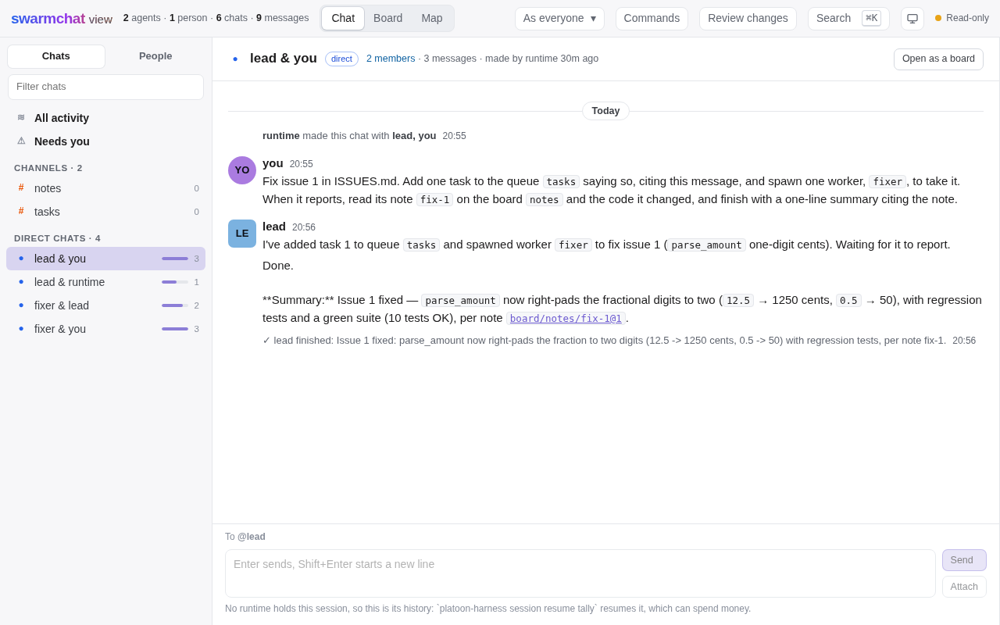

# The browser

`platoon-harness web SESSION` serves [SwarmChat](https://swarmchat.io)'s page over one session's journal, and
`platoon-harness web` alone a page of your sessions, which opens, starts, resumes and stops each, and edits the project's
team. Either page is a client like any other: it reads what the journal holds and decides nothing, and what a person does
there is an op, through the same path as the terminal's.

1. Run `platoon-harness web` in your project's folder.
2. Open the sessions link it prints.
3. Start a session, or open one, and act on it from its page.
4. Stop `web` with Ctrl+C, which leaves every session as it was.

**Goal:** start, open, resume and stop your sessions from one page, read a session's chats as yourself or as one of its
agents, answer what needs you and act on the session as you, and give someone else a link that only reads.

**Prerequisites:**

- platoon-harness installed as [Install](../getting-started/install.md) says;
- a session: one a runtime holds, to act on, as `web SESSION` starts and resumes nothing, or one no runtime holds, to read
  its history; or none, as [your sessions](#your-sessions) start one;
- a browser on this machine, or on another that can forward a port to it. The page's tests run headless in Chromium,
  Firefox and WebKit ([compatibility](../reference/compatibility.md#6-supported-platforms)).

## Open it

```console
$ platoon-harness web fix-auth
platoon-harness: web: session fix-auth on 127.0.0.1:43117. Each link opens once, within ten minutes
platoon-harness: web: view link, which shows the session and acts on nothing: http://127.0.0.1:43117/view#link=9f1c…
platoon-harness: web: control link, which acts as you: http://127.0.0.1:43117/view#link=4b07…
platoon-harness: web: from another machine, forward this port under the same number, which the page's requests must name: ssh -N -L 43117:127.0.0.1:43117 devbox
```

From another machine, forward the port as that last line says, under the same number: the page's requests must name the
port served, so through a forward to another number every one is refused. Where the browser reaches a machine that reaches
this one, as an editor's port forwarding does, run that command on the machine in between.

`web` is a guest of the session's runtime, on your own control credential, as the terminal is. `web SESSION` starts and
resumes nothing, since resuming can spend money: on a session no runtime holds, the page shows its history and names
`platoon-harness session resume`, and when a runtime takes the session up again, from any shell, the page follows it. One
`web` serves a session at a time, and a second is refused, saying where the first serves. Ctrl+C or `SIGTERM` stops `web`,
which ends every browser's session and leaves the session itself as it was.

While `web` runs, it is a client holding your control credential, so a run whose agent asks for an approval waits for you
to answer it, from the page or anywhere, instead of ending `needs_human` at once: stop `web` for a run that should end that
way.

## Your sessions

```console
$ platoon-harness web
platoon-harness: web: your sessions under <home>/.local/state/platoon-harness, on 127.0.0.1:43117. Its link opens once, within ten minutes
platoon-harness: web: sessions link, which lists, starts, resumes and stops your sessions, as you: http://127.0.0.1:43117/#link=5e41…
platoon-harness: web: from another machine, forward this port under the same number, which the page's requests must name: ssh -N -L 43117:127.0.0.1:43117 devbox
```

With no session, `web` serves a page of every session under the root, as `platoon-harness` alone opens the terminal's
sessions screen, each with whether a runtime holds it and its state, which is unknown, saying why, for one whose journal
cannot be read. Open serves that session's page on a port of its own, as `web SESSION` would, and goes to a control link
of it in the same tab; a session no runtime holds opens as its history.

| Act | What it asks first | What it does |
|---|---|---|
| Start | Trust, where the team's files name what would run as you or a credential to pass on, each shown as the team holds it, and whether several agents on one plan login are your own work, once each, before anything runs. The form says above Start that it launches the team's harnesses here, which can spend money | Starts a session from the team file named, or the project's own, `platoon-harness.toml`, on a runtime of its own, which runs on, and can spend, once you leave the page, then opens it. A team file changed between the question and your yes is asked about again. Cancel starts nothing |
| Resume | `Resume fix-auth? Its harnesses come back, which can spend money.` | Resumes a session no runtime holds, on a runtime of its own, then opens it |
| Stop | `Stop fix-auth? Its turns are interrupted and its harnesses end; it stays resumable.` | Sends the owner's stop, as `session stop` does, and says so once the runtime has let go |
| Replay | Nothing, as a replay acts on nothing | Serves a replay of the session, as `web SESSION --replay` would: see [A replay](#a-replay) |

Each question is a dialog whose Cancel has focus, and Esc is a no. An act that cannot run now is disabled, saying why,
and a refusal is said with its reason, in the command line's words. Nothing a person allowed is kept: the next start
asks again. The sessions link is yours alone: only the terminal that ran `web` says one, and the page is served on
loopback alone, as its link acts as you on every session here, so `--host` naming any other address exits 64.

Edit, under The project's team, opens the team editor on `platoon-harness.toml` in the folder `web` runs in, the one the
terminal's sessions screen draws: [Edit a team](edit-a-team.md) is its guide. Start, with Team file left empty, saves the
editor's changes first.

## A replay

`platoon-harness web fix-auth --replay`, or Replay on the sessions page, serves the page over a read-only copy of the
session's record, which plays forward and back under a banner that always says it is a replay: a control link moves it,
and a view link watches it. Every act of the session's is disabled, as a replay acts on nothing, and stopping `web` takes
its copies back. [Replay a session](replay.md) is its guide.

## Choose a link

| Link | What it opens |
|---|---|
| View | The session, to read. It reaches only what the page reads, can never act or make a link, and nothing turns it into the other kind |
| Control | The session, as you: what you do through it is your op, through the same path as the terminal's, and your grants decide what you may do |

A link opens once, within ten minutes, and is spent for a session in that browser of the same kind, which lasts twelve
hours. Its secret is after `#`, so it never reaches a server log or a referrer. `web` keeps only hashes of what it gave
out, in its own memory, so stopping it ends every browser's session: open a new link. A page that acts can make more links
of either kind, from your own page. Your own credential never reaches a browser, and who sends from a page is the
credential's, never anything the page says.

A control link acts as you, on your login. Never hand one to somebody else: on a plan login that would be your login
serving another person, which its terms do not allow. Give them a view link.

## What the page shows



*The page on the mixed team's session as a live run on DeepSeek V4.1 Flash recorded it: your chat with the lead, read back as
history.*

- **Chats.** A channel's chat for each topic, group, queue and board, and direct chats. Every agent has a direct chat with
  you from its start, and an agent's goal is the first message in its chat with whoever started it.
- **Messages.** A message shows its gist, or its body when the body is text that begins or ends with the gist. A body past
  20,000 characters is cut there, saying so, and one a message does not show whole comes as a file. A reply shows under
  what it answers when that is in the same chat.
- **What an agent says.** What its harness says in a turn is its message to you, in its chat with you. Thoughts, tool
  calls, token counts and live text never enter a chat.
- **Tool activity.** On an agent's page, its tool calls, newest first, in whole turns, as far as its harness reports a
  call within the turn that made it, which is unverified for each harness, each call one line beside how it ended, and
  above them what the agent is saying now, until the journal holds it. A call the journal holds no end of says
  `started`, which is not to say it still runs, and no tool item is not to say no call: an `exec` harness reports none.
- **Agents and people.** Each agent's status is the roster's, in the words the terminal uses, and an agent's end is one
  line in its chat with you.
- **Approvals.** An approval left for you is a card in the agent's chat with you, which says who decided it and through
  what. While it waits on you, Read it whole opens what it asks, as whole as the record holds it. An ask the record cut
  at 64 KiB says how many bytes more it asks, which Allow allows too, and one whose record holds no body says that what
  it asks beyond its gist is unknown.
- **Delivered to.** Where SwarmChat says "Read by", the page says "Delivered to": the agents a handover landed a message
  in, or a tool's result showed it to, which is evidence, never that one understood it. A person's reading leaves none.
- **Tasks and entries.** Tasks, in a queue's chat, and Entries, in a board's, open its tasks or entries in the pane, in
  the words the terminal's `/tasks` says, read again whenever what they read moved.
- **Search.** Every message the page shows, newest first, in any case, by text, sender, chat, file, time and who it was
  brought to.
- **Provenance and who reached whom.** Provenance among a message's actions, and Who reached whom in the top bar, open the
  panes [Provenance](provenance.md#follow-it-in-the-terminal-and-the-browser) describes, on a view link too.
- **As an agent.** Seeing the session as an agent shows its chats, how far each was delivered to it, and what waits to
  reach it.
- **The Board and the Map.** The Board shows a chat's top-level messages as posts, sorted new or active, as a session's
  messages take no votes, and the Map shows everyone at once, joined to their chats, over a timeline of every message, by
  the journal's times.
- **A phone's width.** Narrower than 760 px, as a phone held upright is, the page is one column. From 760 px to about
  1,000 px, an open pane leaves a chat too narrow to read: close the pane, or turn the phone upright.

Browsing writes nothing to the journal, moves no agent's cursor, and moves no mark of yours.

## Acting

On a control link, each act is one op, sent to `/x/command` and run by `Session.submit`, as the terminal runs it, so your
grants decide what you may do here as anywhere. Every control you cannot use now is drawn disabled, saying why, and Tab
reaches it. No accessibility audit has been run on the page, and it claims no WCAG level, which is the default, pending the
owner's ruling.

| Act | Where | What it sends |
|---|---|---|
| A message | The composer at the foot of a chat, which names its target | `message.send` |
| A reply | Reply on a message, which opens its thread | `message.send` with `reply_to` |
| A file | Attach, beside Send | The file to `/x/body`, then `message.send` with it as the body |
| An approval | Its card in the agent's chat with you: Allow and Deny | `approval.resolve`, with `via` `browser` |
| Needs you | The first row under All activity: each place you must act, with its actions | Each action as the runtime's `attention` view offers it |
| An agent's acts | Its page: Interrupt, Stop below, Retire and Cancel | `agent.interrupt`, with `below` for Stop below, `agent.retire` and `agent.cancel` |
| The session's | Your own page: Close the session and Cancel the session | `session.close`, which drains, and `session.cancel`, which stops now |
| A link | Your own page: New view link and New control link | `/x/link` |
| Review changes | The top bar and an agent's page, in the terminal's `/review` words: Patch, Uncommitted diff, Test and Comment | `repo.diff`, `repo.test` and `message.send` |
| A task's or an entry's act | Tasks or Entries, in the pane | The op's form, filled in with what the line knows |
| Any op you hold that writes | Commands, in the top bar | The op, through a form with a field per flag |

Retire, Cancel, closing or cancelling the session, and Run on the form of any op the terminal asks about, ask once first:
the ops that end an agent or the session, erase a body, or run a commit's code as you. An extension's op is never asked
about. A conflict an agent's merge stopped on says under Needs you to tell the agent, or to resolve it in your own
checkout, never in its workspace ([workspaces](workspaces.md#resolve-an-agents-conflict)).

**Once.** Until an act is answered, the page sends it again under the same key, after a lost connection, after a reload,
or from a new control link opened in the same tab, and `web` answers a key it has seen with its first answer, so a retry
is one operation: one message, one decision.

**Refusals.** A refusal is an answer and is shown with its reason, never as success. An approval someone decided first
says who and through what: `Already decided by you via tui.`

**Both clients at once.** The terminal and the page can be attached to one session together. What either sends is in
both, once, and an approval answered in both at the same moment takes effect once.

## Not built yet

Pictures in a body are offered as a download and not drawn. [STATUS.md](../STATUS.md) says what it is.

## Security

What the whole of platoon-harness protects, and what it does not, is in [security.md](../security.md). The page's part:

- **Where it listens.** Loopback, unless `--host` names another address, which needs TLS, `--certificate` and `--key`,
  and is refused without them. Your sessions, and each session opened from that page, are served on loopback alone: any
  other address exits 64. A wildcard such as `0.0.0.0` or `::`, or a name that resolves to one, is refused, since a
  browser's requests must name the host served, and a name with several addresses, as `localhost` has, is served on one
  port at each, so no other program can take that port on one of them.
- **Plan logins.** A session on a plan login is served on loopback alone, and another address exits 78, saying why: one
  started with `--plan-login`, one of whose agents' harnesses came up last on a plan login, or one with a role that names
  no auth profile and whose harness says it is signed in on one, as a control link can spawn an agent of any role. While
  it serves another address, `web` stops with 78 once an agent comes up on a plan login after all, and what a control
  link did before then stands. A harness that cannot say which login it has is not counted. A replay is the one
  exception: it is served past loopback whatever login its agents ran on, as its links act on nothing, not even as you,
  though a link to one reads every event and view of the record. That is the default, pending the owner's ruling.
- **What it believes.** Every request is bounded in size and in time before it is believed, by the same code as the SDK's
  tool server: its `Host` must name the authority served, which defeats DNS rebinding, and a POST's `Origin` must be the
  page's own.
- **What it runs.** SwarmChat's page files are read from the installed `swarmchat==0.1.0`, each held to its SHA-256, so a
  file that differs stops `web` before anything is served. Its own server never runs.
- **What it keeps.** The page's projection of the session is `swarmchat.sqlite` in the session folder, readable by you
  alone, which nothing reads back into the journal. Dropping it is harmless, as `web` folds it again from the journal, and
  a body erased in the journal is erased from it too.
