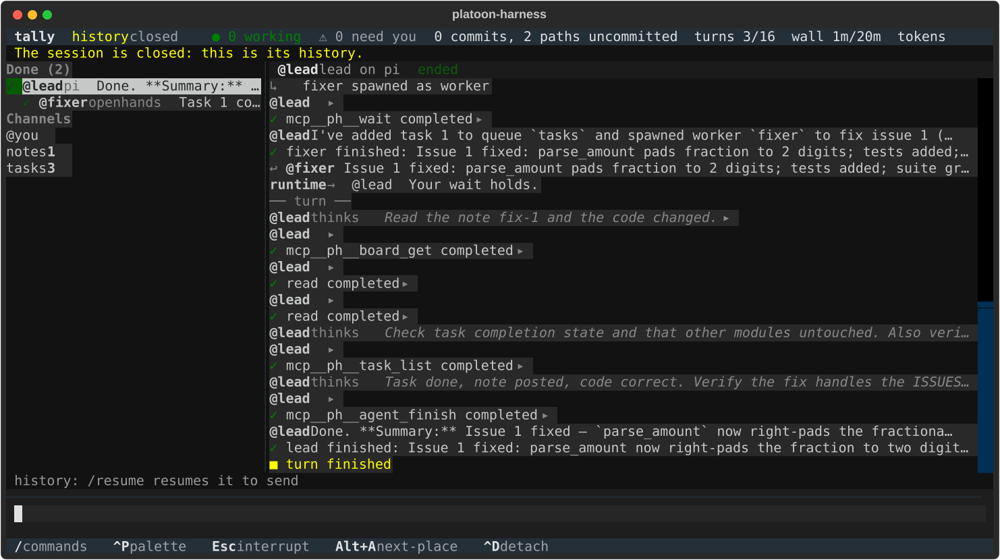

# A mixed team

**Goal:** run a Claude Code lead and a Codex worker in one session, watch and steer it while it runs, and read back
whose work reached the lead's answer, or run the same team with no keys, on scripted stand-ins.

A Claude Code lead and a Codex worker in one session. The lead puts a task on the queue `tasks` and starts a worker; the
worker claims it, writes a note on the board `notes` and reports back by message; the lead reads the note and finishes.
Every write may cite what it rests on, which the default template asks each agent to do, and afterwards the record says
whose work reached the lead's answer.

**Prerequisites:**

- a checkout of this repository with its packages installed, as [the README](../../README.md#install) says;
- for a run on real models, `claude` and `codex` on your PATH and signed in as you usually are. The run with no keys
  needs neither.

The example has three files:

| File | What it is |
|---|---|
| [`team.toml`](team.toml) | The team: two roles, the `manager-worker` preset, which gives the queue and the board, and a budget of 12 turns and 15 minutes, so a runaway stops itself. Both agents work in the session's own checkout, the `shared` workspace |
| [`job.md`](job.md) | What you ask of the lead |
| [`stand_ins.py`](stand_ins.py) | Scripted stand-ins for both harnesses, for the run with no keys |

## 1. Run it

With `claude` and `codex` on your PATH and signed in as you usually are, from a checkout of this repository:

```console
$ uv run platoon-harness team check examples/mixed-team/team.toml --plan-login
$ uv run platoon-harness run --team examples/mixed-team/team.toml --prompt-file examples/mixed-team/job.md \
    --plan-login --name dns
```

`--plan-login` says you mean to run two agents on plan logins at once, which a headless run refuses otherwise, with exit
78. The run says the session's name on stderr at once, owns the session in the foreground until the lead finishes, and
exits 0 once it has settled. Live, this cost 11 model calls on `claude-haiku-5-5` and `gpt-6-luna` at low effort. Both
agents work where you run it, the checkout itself here: nothing the job asks writes a file, but each agent has a shell.

### With no keys

Scripted stand-ins, in [stand_ins.py](stand_ins.py), do what the job asks, each citing what it rests on, with no model
at all:

```console
$ PYTHONPATH=examples/mixed-team uv run platoon-harness run --team examples/mixed-team/team.toml \
    --prompt-file examples/mixed-team/job.md --set 'roles.lead.harness = "stand_ins:lead"' \
    --set 'roles.worker.harness = "stand_ins:worker"' --name dns
```

It prints a line per event as the session journals it, and ends with how the session ended and each agent's last words:

```text
settled, exit 0
  @lead            finished  Three risks of caching DNS answers are on the board.
  @w               finished  The risks are on the board as risks.
```

The test suite runs this file that way, from the command line in `tests/integration/test_examples.py` and from the page
with the terminal UI attached in `tests/e2e/test_examples.py`, and on the real `claude`, `codex`, `pi` and OpenHands
against FakeModel, a loopback model that replies from a script: a Claude Code lead beside each of the other three in
turn, since those three read one variable for where their model is. [docs/STATUS.md](../../docs/STATUS.md) says what ran
live.

Either run names its session `dns`, and a name is taken once: a second run named `dns` is refused, with exit 64, so give
it another `--name`, and use that name in the steps below.

## 2. Watch and steer it

To watch and steer it while it runs, from another shell:

```console
$ uv run platoon-harness attach dns    # the terminal UI, as a guest of the running session
$ uv run platoon-harness web dns       # SwarmChat's page; open the control link it prints
```



*The terminal UI on another session, of scripted harnesses, as its snapshot test draws it.*

A message from either goes to whoever you address, `@lead` or the worker, and a person's message steers. Or start the
whole thing from the terminal UI: `uv run platoon-harness`, then start a session from `examples/mixed-team/team.toml` on
its sessions screen, type the job in the composer, and `platoon-harness web` the session it made.

## 3. What to look at

The queue, the board and the messages are ordinary commands on the session, live or closed:

```console
$ uv run platoon-harness task list dns --queue tasks
$ uv run platoon-harness board get dns --board notes --name risks
$ uv run platoon-harness message read dns --channel @lead
```

Provenance: in the terminal UI, choose the line of the lead's answer and type `/provenance`; in the page, Provenance is
among a message's actions. Each opens on one event, with its sources, its uses and its contributors, each link by how it
is known. From the command line:

```console
$ uv run platoon-harness uses dns --ref board/notes/risks@1           # what cites the note, and whom it was handed to
$ finish=$(uv run platoon-harness uses dns --ref board/notes/risks@1 \
    | jq -r '.rows[] | select(.type == "agent.finished" and .maker == "agent:lead") | .ref')
$ uv run platoon-harness contributors dns --ref "$finish"             # whose work the record ties to the lead's finish
```

`uses` names the lead's finish, its `agent.finished`, among what cites the note, with its ref, which is what to ask
`contributors` about; the ref differs from run to run, so the second line picks it from `uses`. `contributors` is
reachability in the record and never credit: it weighs and ranks nobody, and a citation is its agent's claim.
[docs/how-to/provenance.md](../../docs/how-to/provenance.md) says how to read each answer.

## 4. Other harnesses

A role's harness is one setting, so swap it with `--set`. Pi signs in as it does in your shell:

```console
$ uv run platoon-harness run --team examples/mixed-team/team.toml --prompt-file examples/mixed-team/job.md \
    --plan-login --set 'roles.worker.harness = "pi"'
```

OpenHands keeps no login, so its role needs a model and a key, named by an auth profile, and the SDK's `openhands`
extra, which `platoon-harness doctor` says how to install
([docs/extending/drivers.md](../../docs/extending/drivers.md#openhands-a-wire-worker)). Name the model your key reaches:

```console
$ uv run platoon-harness run --team examples/mixed-team/team.toml --prompt-file examples/mixed-team/job.md \
    --plan-login --set 'roles.worker.harness = "openhands"' --set 'roles.worker.model = "MODEL"' \
    --set 'auth.openai.env = ["OPENAI_API_KEY"]' --set 'roles.worker.auth = "openai"'
```
